# 出发之前

去河内是个临时决定。五月中旬，机票便宜到不像话，签注简单，客栈房卡上印着"197 Thanh Nhàn"——二征夫人郡的一条安静小街，离老城区两公里，走路能到还剑湖。就这么定了。

出发前对河内的全部想象，浓缩成两个词：摩托车，和法式老房子。四天下来，这两个印象都对，也都太简单了。

# 第一天：先是老城，再是洪流

中午到达，放下行李就往老城区走。老城的入口毫无仪式感——一条挂着"ĐIỆN NƯỚC"（水电维修）、"VẬT LIỆU XÂY DỰNG"（建材）招牌的临街小店从旁边掠过，法式黄墙老楼和头顶蛛网一样的电线一起扑面而来。这里没有滤镜，招牌、电线、摩托和晾衣杆密密实实地长在一起，却长得理直气壮。

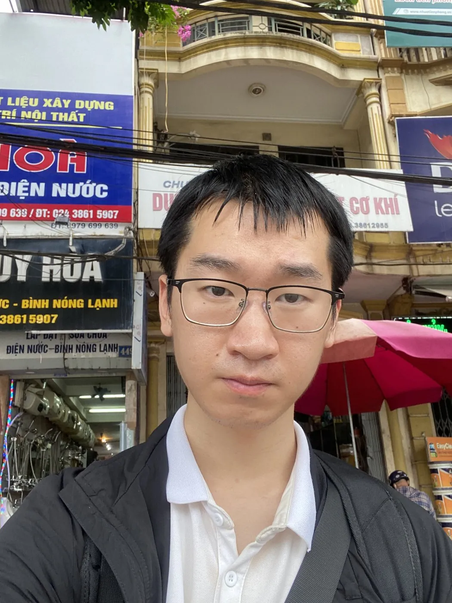

下午闲逛，一路走到了西湖边的乐天商圈。站在天桥上看晚高峰——第一次见识河内的摩托洪流。绿灯亮起不是车流涌动，是洪水开闸。路口没有试探，没有犹豫，所有人以同一个频率向前涌，整齐得像被同一只手指挥。

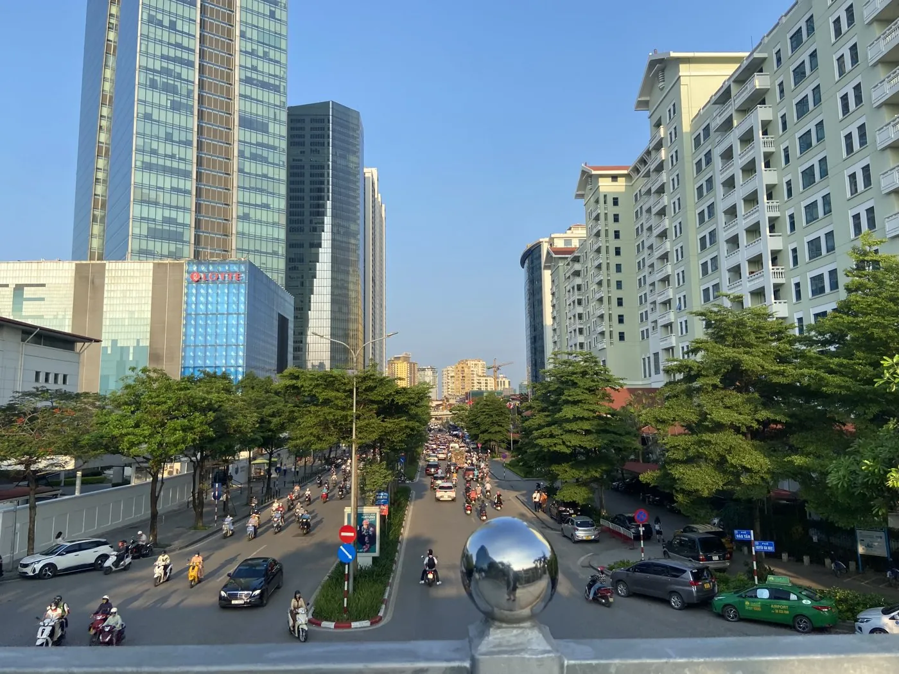

学会过马路是河内的第一课。诀窍是：**匀速、坚定、不看车**。你只要保持速度往前走，摩托流会像水绕过石头一样绕过你；一旦你停下或者变向，反而危险。听起来疯狂，试过之后居然真的可行——这是这座城市教给我的第一份信任。

天黑后来到还剑湖。白天的喧嚣退去，湖面把岸边的灯火全部接住，垂柳、路灯、对岸的高楼天际线，都泡在一汪安静的光里。

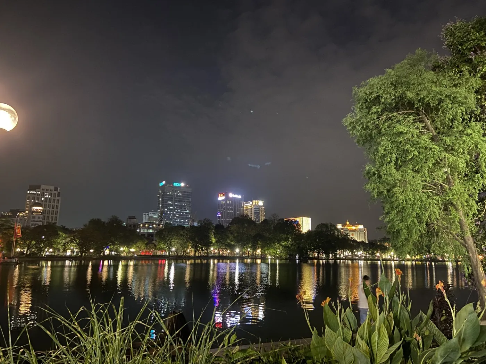

夜里顺着 Tràng Tiền 街走到大剧院，门口立着演唱会海报——"River Flows in You"，MUSIC GARDEN，五月的河内连街头都在发生着什么。

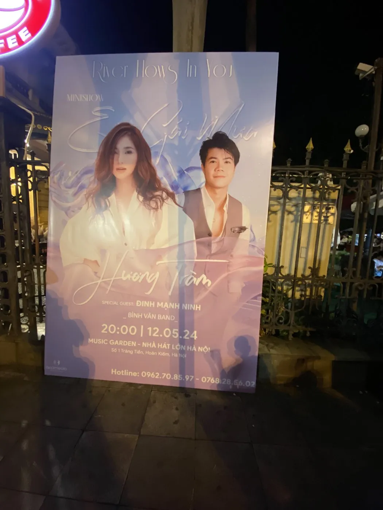

走近才发现，海报说的不是预告，是正在发生：大剧院门前的小广场上真的搭起了台，乐队正在演出，绿色激光扫过法式立面，观众窝在藤椅咖啡座里，头顶的大风扇慢悠悠摇着脑袋。没买票，站在边上蹭了大半首。

<figure><video controls preload="metadata" poster="images/hanoi/IMG_1101.jpg" src="images/hanoi/IMG_1101.mp4" playsinline></video><figcaption>MUSIC GARDEN 露天演出现场，观众席就是咖啡馆座（当日实拍视频）</figcaption></figure>

<figure><video controls preload="metadata" poster="images/hanoi/IMG_1102.jpg" src="images/hanoi/IMG_1102.mp4" playsinline></video><figcaption>灯光扫过大剧院立面（当日实拍视频）</figcaption></figure>

# 第二天：咖啡因和霓虹

河内的早晨从一份油纸包的点心开始。木托盘、小马扎、街边的矮桌，这是这座城市的标准餐桌。

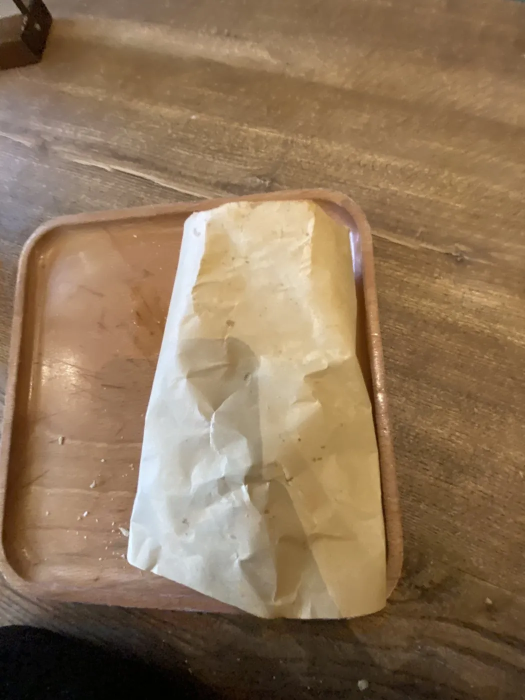

傍晚钻进一家 Cộng Cà Phê——越南的国民咖啡连锁，走军旅复古风，水泥墙、深绿天花板、搪瓷缸子。纸吸管插在印着绿色"CÔNG"的玻璃杯里，窗外天色一点点暗下去。这家店在河内有很多家，随便挑一家坐下，都值得。

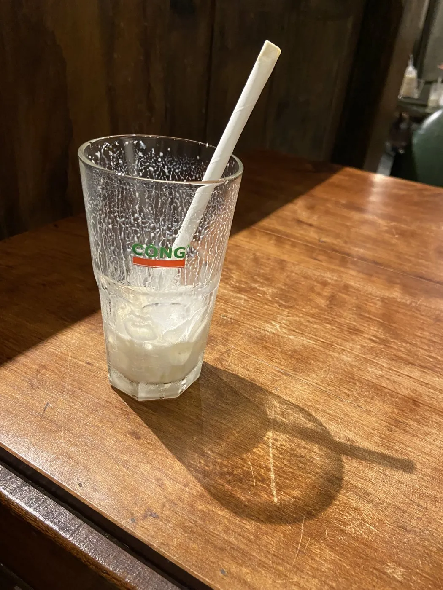

真正的重头戏在深夜：老城区的夜市。霓虹招牌从一座圆筒形老楼上层层叠叠地挂下来——LAIKA Café、青柠茶、HANOI 1950-1954，每一层都在发光。人行道上摆满绿色塑料矮凳，煎饼浇着木鱼花在铁板上滋滋作响，出租车从马路中间开过，车上的人举着手机拍这一街的烟火气。

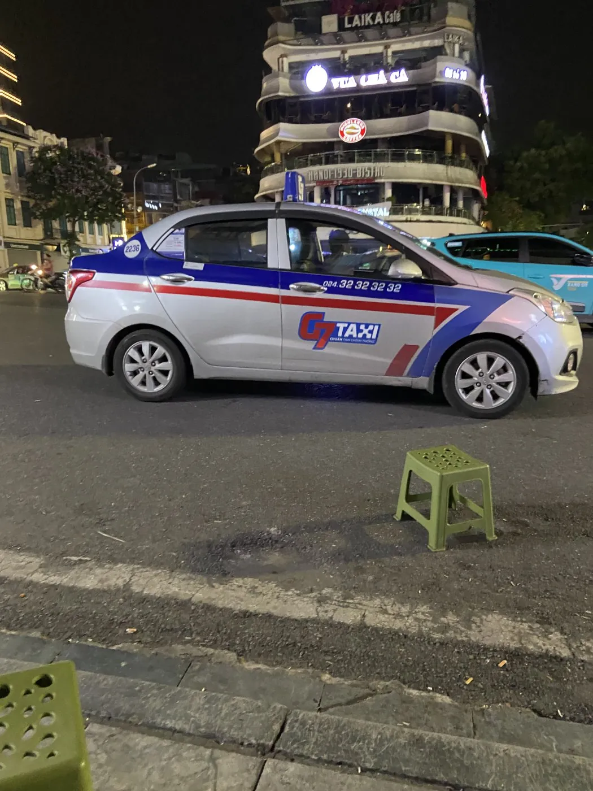

# 第三天：教堂、广场、西湖

第三天上午先去圣若瑟大教堂。两座哥特式双塔立在街口，正门上方有时钟、十字架和玫瑰圆窗，门口已经聚了不少游客。它长得确实像巴黎圣母院——据说是按它的样子缩建——但门前的街景一点不巴黎：摩托车从教堂前的广场斜穿而过，教士和外卖小哥共享同一段树荫。

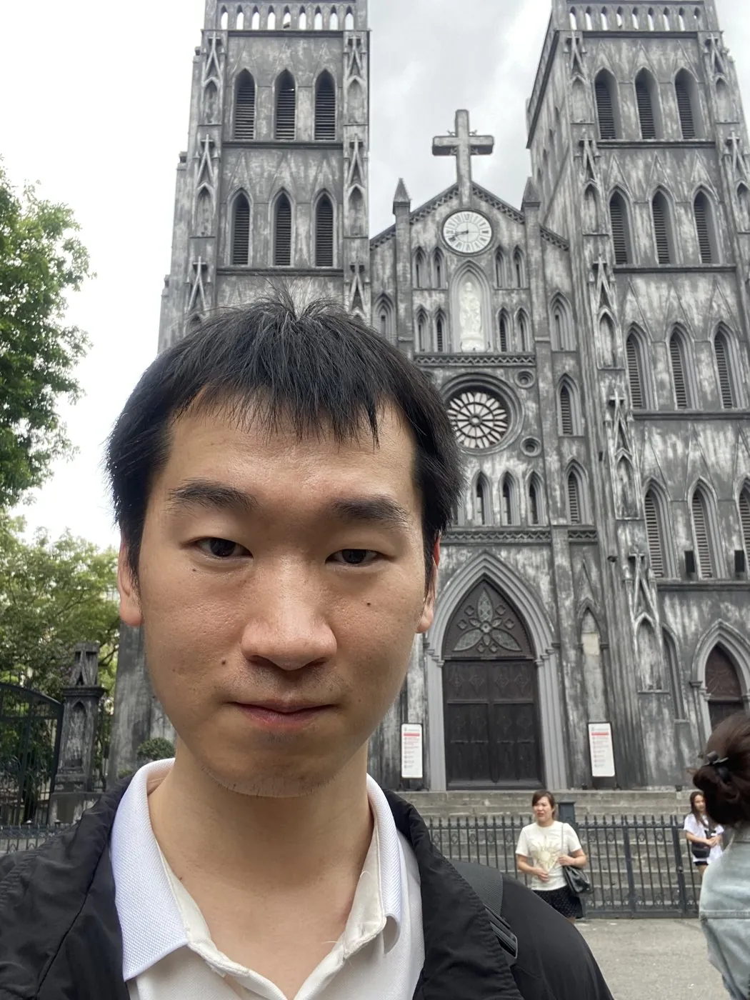

从教堂出来，我们拐去了火车街。铁轨从窄巷正中穿过，两旁的咖啡馆把矮凳摆到离轨道只有一步远，头顶挂着竹编灯笼和红灯笼。九点二十分，人群忽然骚动——一列红色的内燃机车贴着店铺迎面驶来，风裹着柴油味扫过每一张脸。几十秒后巷子恢复安静，咖啡继续，仿佛什么都没发生。

<figure><video controls preload="metadata" poster="images/hanoi/IMG_1124.jpg" src="images/hanoi/IMG_1124.mp4" playsinline></video><figcaption>火车贴脸驶过的三十秒（当日实拍视频）</figcaption></figure>

然后是巴亭广场。从老城一路向西北，街道渐渐开阔。广场大得过分，草坪修剪得整整齐齐，中轴线尽头就是胡志明纪念堂——灰色大理石的柱廊式建筑，安静地压住整个广场的重心。旗杆上红旗猎猎，两侧的标语牌上写着"CHỦ TỊCH HỒ CHÍ MINH"。

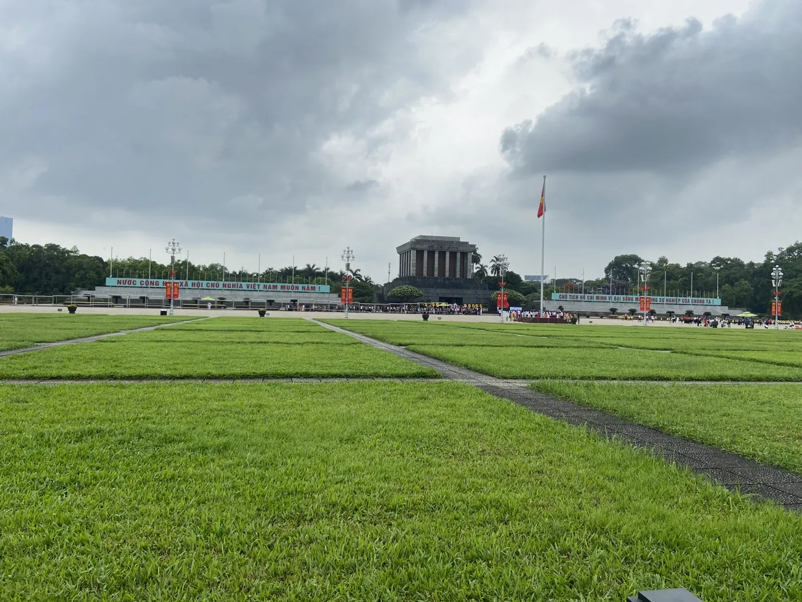

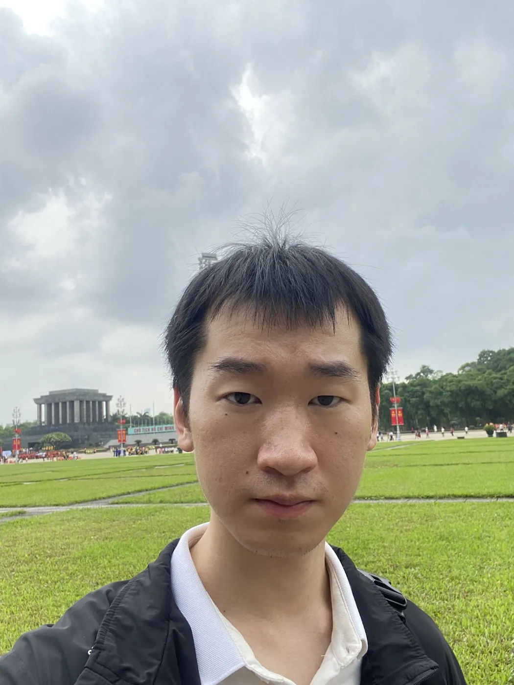

广场的西北边就是西湖。这是河内最大的一汪水，和还剑湖的小巧完全是两种性格。湖边有出租天鹅脚踏船的码头，橙色尖顶的酒店倒映在水面上，我们租了船，慢悠悠地漂了一个钟头，什么也没干，就看对岸的楼群和头顶的云。

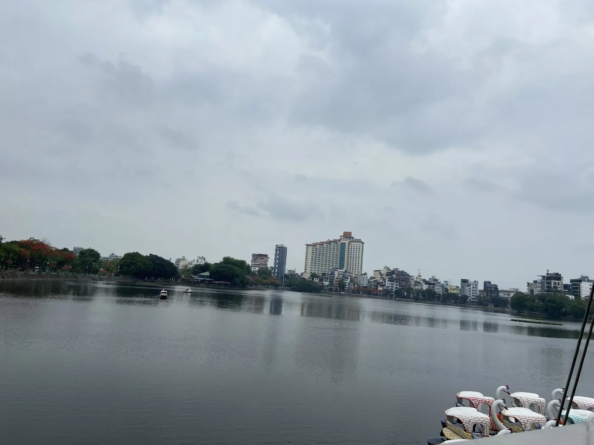

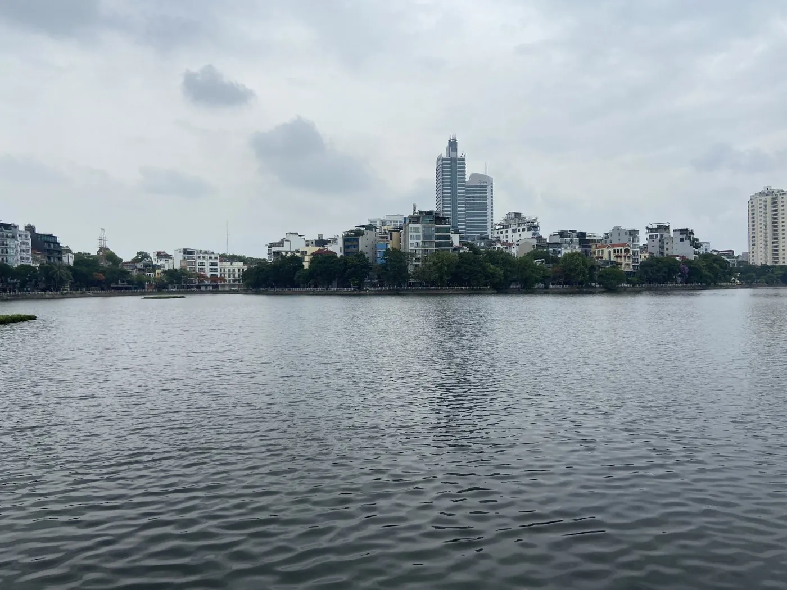

湖畔有 Highlands Coffee，点一杯抹茶奶盖，坐着看天鹅船一艘艘靠岸。旅行里最好的时光大抵如此：什么景点也不在，什么行程也不赶。

# 第四天：一碗有故事的米线

最后一天上午，先在歌剧院前的八月革命广场转了一圈——莲花雕塑的环岛，穹顶的 Agribank 老楼，越南国旗在楼顶飘。

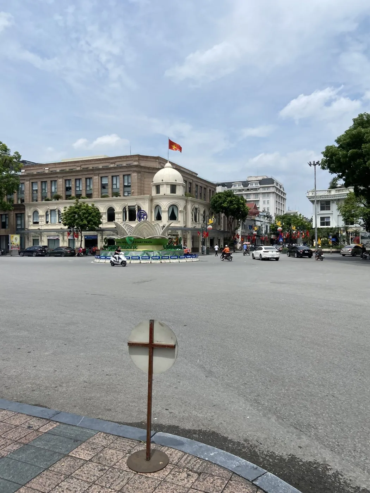

然后去办正事：吃奥巴马吃过的那家烤肉米线。

Bún Chả Hương Liên，在二征夫人郡 Lê Văn Hưu 街，一家毫不起眼的本地小馆。2016 年奥巴马和 Chef Bourdain 在这里的一张矮桌前吃过一顿，从此菜单上多了一行"COMBO OBAMA"，120,000 越南盾，墙上还挂着两人的合影。

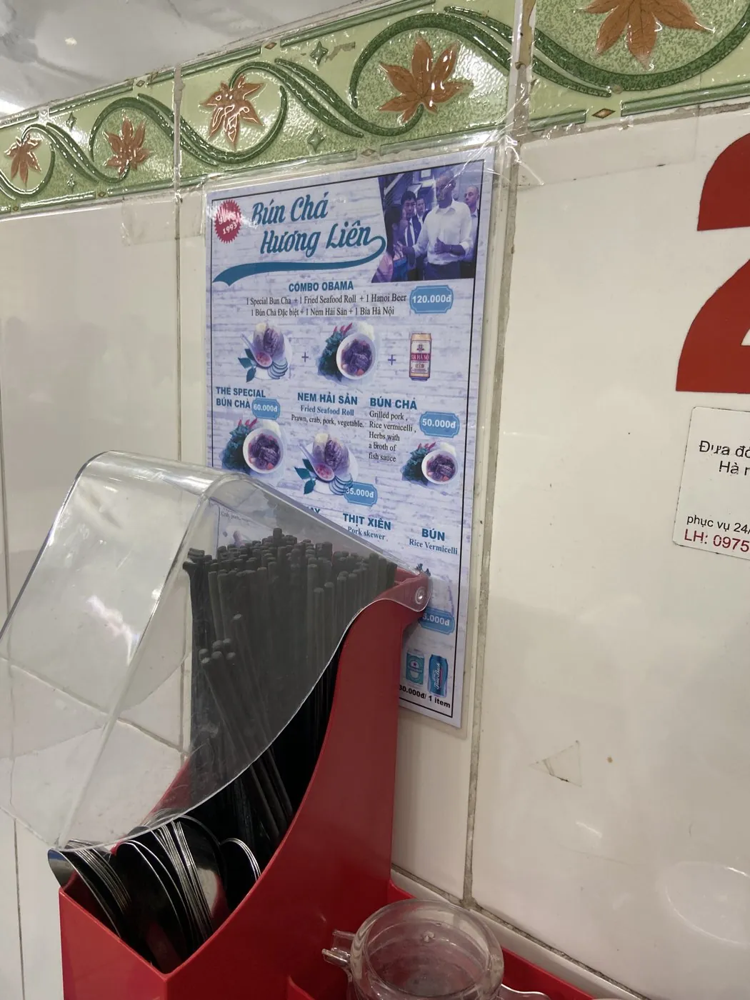

套餐上桌：炭烤的肉饼浸在酸甜蘸汁里，配白米粉、炸春卷和一大盘生蔬香草，再加一罐 Bia Hà Nội。不锈钢桌子，蓝色塑料凳，电风扇在头顶吱呀转。味道谈不上惊艳，但那口炭火香混着蘸汁的酸甜，就着河内的热风吃下去，值回票价。

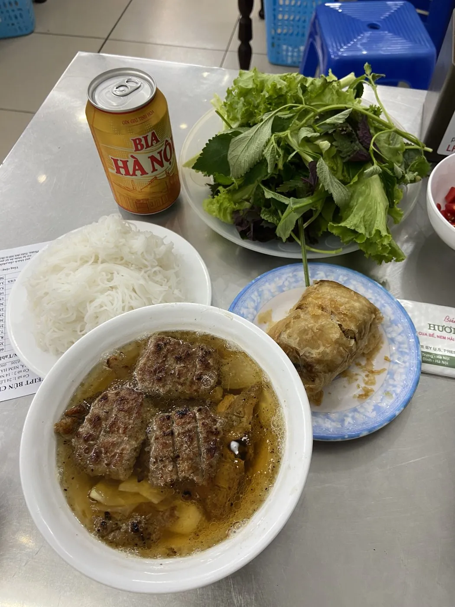

饭后在老城钻进一家旧咖啡馆。斑驳的黄墙，"BẢNG GIÁ CAFE"的价目牌，"CẤM HÚT THUỐC"的禁烟牌，墙上贴着褪色的旧海报。点了一杯叶形拉花，木桌矮凳，拱门里漏进一点街声。四天的行程，就在这杯咖啡里收了尾。

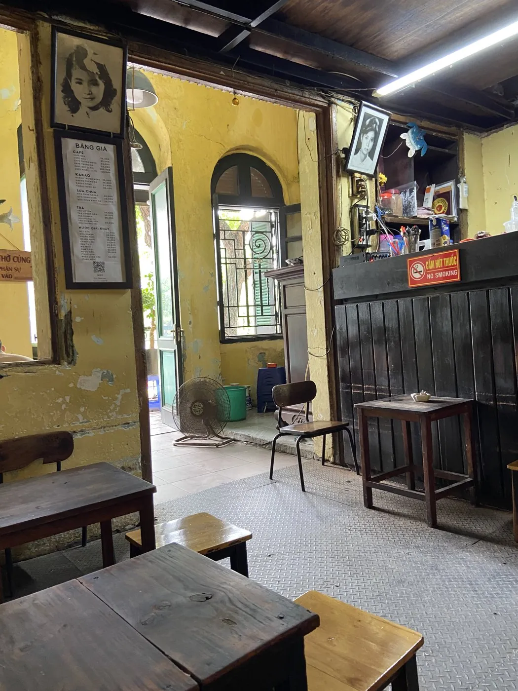

# 手记

离开前整理照片，发现四天里拍得最多的不是地标，是街：招牌、电线、摩托、矮凳。河内的好看不在明信片上，在街面上。

几条实用的：

- **过马路**：匀速、坚定、不看车，摩托流会绕开你；
- **圣若瑟大教堂、巴亭广场**：免费，早上人少光线好；
- **胡志明纪念堂**：上午开放，注意闭馆日，着装不要太随意；
- **西湖**：租一只天鹅船，比任何行程都治愈；
- **COMBO OBAMA**：120,000đ，出片，味道也在及格线之上；
- **住宿**：二征夫人郡一带性价比高，到老城区步行可达。

湖光、教堂、洪流、米线——四天刚刚好。下一站，下龙湾。
