# 出发之前

行李里能证明这趟行程的东西很少：一张紫色的航线宣传卡，印着"在飞日韩、东南亚航线"，"西安 Xi'an"三个字被红色高亮，压在一本证件上面。五一的假期被切得零零碎碎，金边就塞在其中一截——晚上八点半落地，次日中午十二点的登机口，满打满算，十五个小时。

出发前对金边的想象只有两个词：王宫的金顶，和洞里萨河的日落。十五个小时后核对答案：日落一个没赶上，赶上的是日出。

# 夜里十点，先跟突突车司机吵了一架

金边的第一课在车轮上。落地已是夜里，摸上当地的突突车，红色的车厢内壁贴着三语禁烟标——高棉文、中文"请勿吸烟"、英文"NO SMOKING"并排。三个语种里我一眼看懂两个，剩下那个负责提醒我：已经到柬埔寨了。

真正的麻烦在付钱。司机开口要瑞尔，我身上只有美元，也没打算换——这个国家的价签明明到处写着美元，我想一路用到底。一沓美元找不开零，两个人隔着车斗僵持，谁也没说服谁。

车碾过夜色，先经过的是中餐街。整条街的灯箱都在用中文报菜名：「音乐烧烤 隆江猪脚饭」，底下三块小牌排开——"S329 老蔡椰子鸡""S329 万州烤鱼""S329 酸菜鱼"；隔壁的 LED 大字是「泰福猪肚鸡」，副行一行小字：食材鲜，汤才鲜。

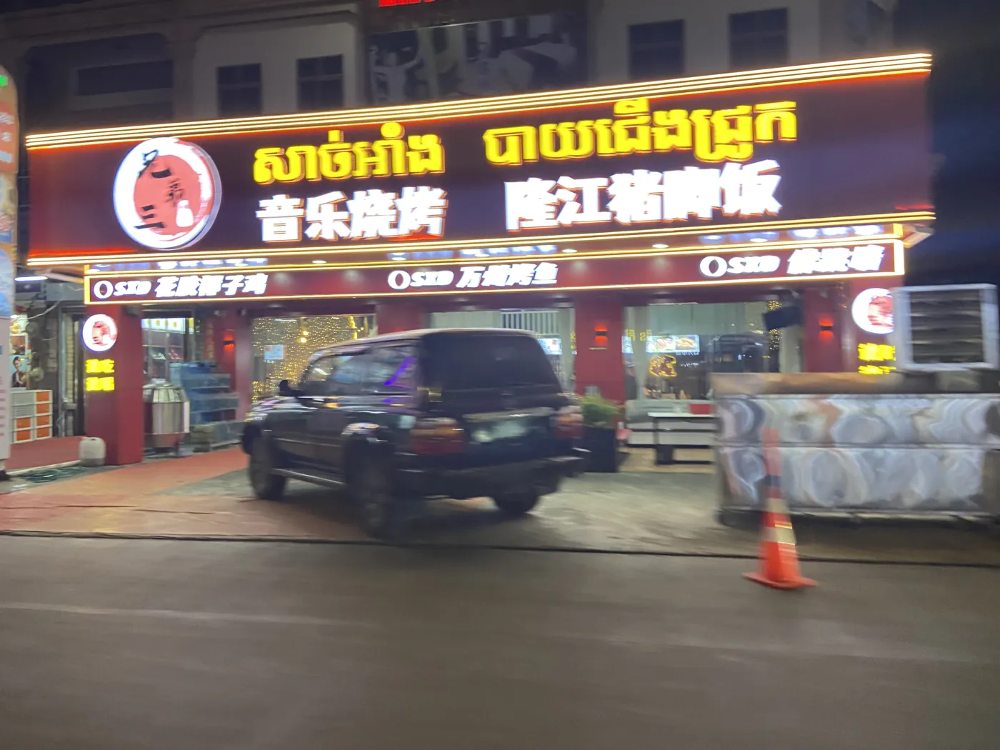

最后既没吃猪脚饭也没吃猪肚鸡。我在街角找到一家 Little Caesars——小凯撒，在美国火得一塌糊涂的披萨连锁，没想到在金边撞见一家。买它的理由一半是馋，一半是私心：用美元结账，把大票换开。结果店家不肯换汇，找回的仍是瑞尔——我的钱包里第一次躺进高棉的纸币。十点零四分，这只系着塑料袋、掀开盖印着"PIZZA! PIZZA!"的薄底蟹柳披萨，把车费的问题解决了。

# 凌晨三点，整座城市还没醒

三点半，人躺在床上睁着眼。索性不熬了，五点出门——后来证明，这是整趟行程里最正确的一个决定。

清晨的街道属于另一群人：金铺的卷帘门还没拉起，"Ai-CHA ICE CREAM & TEA"和"Smell Coffee"都黑着灯，街角鎏金神龛里供着粉色的汽水。黄红配色的嘟嘟车停在路边，车尾一枚红色菱形的 Grab 标；一家汽修店的条纹雨棚下，日本国旗和柬埔寨国旗挂在一起。

五点二十八分，中央市场的穹顶从街口探出来。Art Deco 的奶白色圆顶配一列梯形长窗，红伞摊位还收在阴影里，天是粉紫色的。日头没上来，整座广场只属于零星几个早起的人。

<figure><video controls preload="metadata" poster="images/phnompenh/IMG_3454.jpg" src="images/phnompenh/IMG_3454.mp4" playsinline></video><figcaption>镜头从街口平移扫过中央市场正面的 Art Deco 塔楼和红绿遮阳伞（当日实拍视频）</figcaption></figure>

# 一美元的塔山，和河上的日出

金边（Phnom Penh）这个名字说的就是它——Phnom 是山，这座城因塔山得名。我绕着走的那一圈，正是这座城市名字的来历。

其实，来塔山的路上就先见过国王了。路边一面奶白色的墙龛里，金框画像上是白色礼服军装的老人——金色肩章、金领链，背景是金殿王座，底下一行高棉文写着他名字的全称：诺罗敦·西哈莫尼。后来一整天，这种肖像见了无数次：金铺旁边有，铁皮棚底下也有。国王在这里不常出现在新闻里，因为他一直在墙上。

山不高，塔不险：灰白的石塔层层收拢，壁龛里的立像披着金绶带。我没有上去，就围着山脚转了一整圈——纳迦栏柱引着金色的山门，张口卷毛的石狮守在粉砂岩的基座旁，绕到石阶口，先看见售票的蓝牌子："FOR FOREIGNER ONLY / PLEASE PAY HERE / 1$ ONE PERSON"。一美元一位，钉在墙上，是这趟旅行里被研究得最认真、却始终没有花出去的一美元。

去河岸的路上，我留了一段十一秒的视频。开头几秒拍得很陡，镜头几乎怼着自己的鞋面——不是艺术处理，是自我保护：街上飞车抢手机的传闻听得人心里的弦一直绷着，而手机里存着这趟行程的全部素材，真被抢走，是连回忆一起被抢走。走稳了才敢把镜头抬起来，路面上的落叶、地砖和蓝色装饰块先歪歪斜斜地进了画面，然后是环岛、公交和鸽子。

<figure><video controls preload="metadata" poster="images/phnompenh/IMG_3490.jpg" src="images/phnompenh/IMG_3490.mp4" playsinline></video><figcaption>去河岸的路上：先护着手机拍地，走稳了才抬起来（当日实拍视频）</figcaption></figure>

六点过二分，太阳从洞里萨河对岸的楼群后面出来。河面把光摊平，对岸的高层楼群刚刚显出轮廓，双层观光游船泊在岸边；石狮和七头纳迦的扇形石雕立在水边，一条木栈道伸向河心，一条废弃的木壳游船搁在栈桥旁。

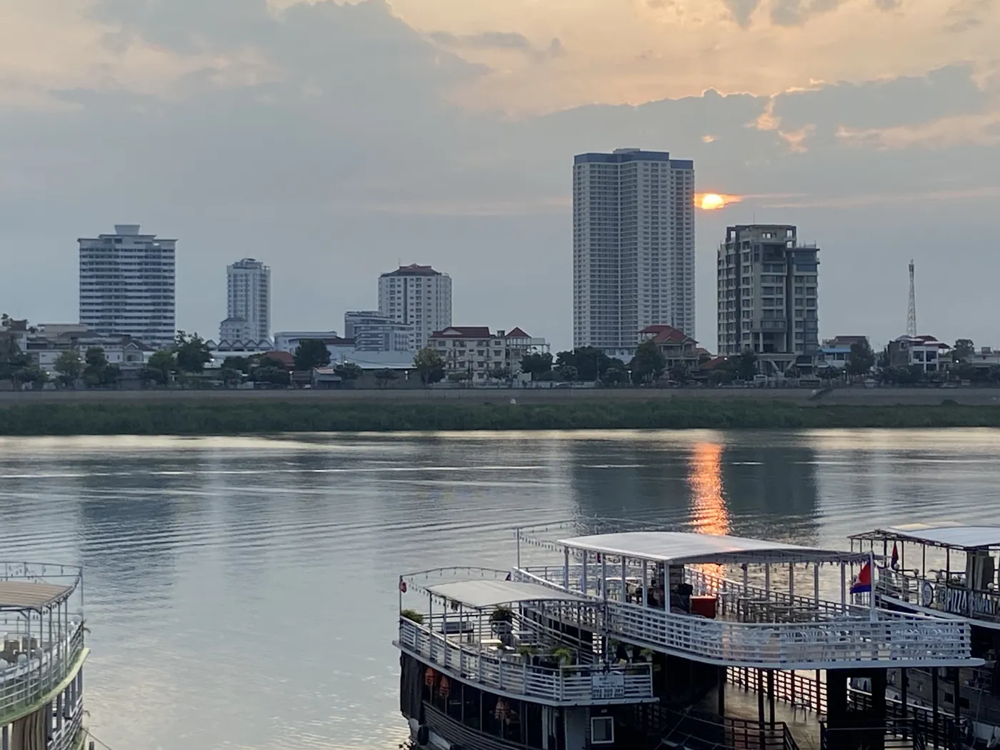

# 王宫的黄墙，和广场上的鸽子

金边的历史景点挤在河岸两公里内，从塔山脚下沿河走到王宫，像串门一样就到了。

串门路上的第一座院子不是王宫，是国家博物馆。六点半远没到开门的钟点，门口白牌写着「OPEN DAILY」，开放时间 8:00AM - 5:00PM，成人票 10 美元。隔着红色铁艺栅栏往里看：一整片红陶色的建筑连成一体，层叠的红瓦尖顶，中央一座白色塔刹，庭院里立着神鸟伽鲁达的石雕——十五个小时的人，连这座红宫殿也只能从栏杆外整组带走。

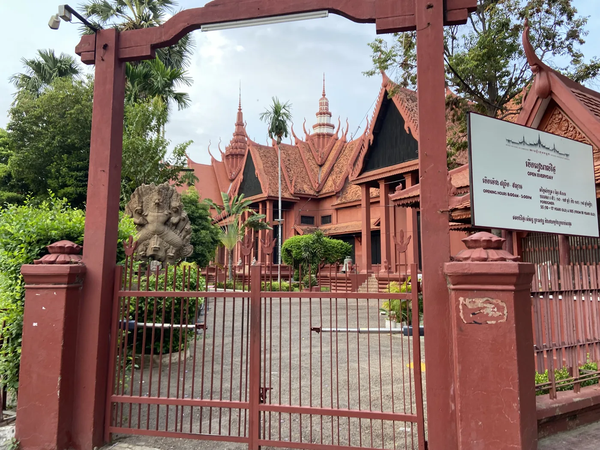

<figure><video controls preload="metadata" poster="images/phnompenh/IMG_3530.jpg" src="images/phnompenh/IMG_3530.mp4" playsinline></video><figcaption>沿国家博物馆红色铁艺围栏横摇：红陶墙、层叠尖顶，结尾摇到鎏金馆名（当日实拍视频）</figcaption></figure>

明黄色的围墙沿街铺开，金色门楼，红金屋顶，白色卫塔顶着金色尖顶。六点四十分，王座殿的蓝金配色屋顶在晨光里发亮，门前石狮还没等到第一批游客。

沿墙往南，撞见一棵开粉紫色花的大树：碎花挤成一团团的花簇，缀在绿叶和光秃的细枝之间，树干下半截刷着白灰。粉花压着明黄宫墙和白色宝瓶栏杆，远处探出王宫的金尖顶，两辆摩托一左一右停在树下——这堵明黄的墙天天被人拍，这个早晨却归了这棵树。

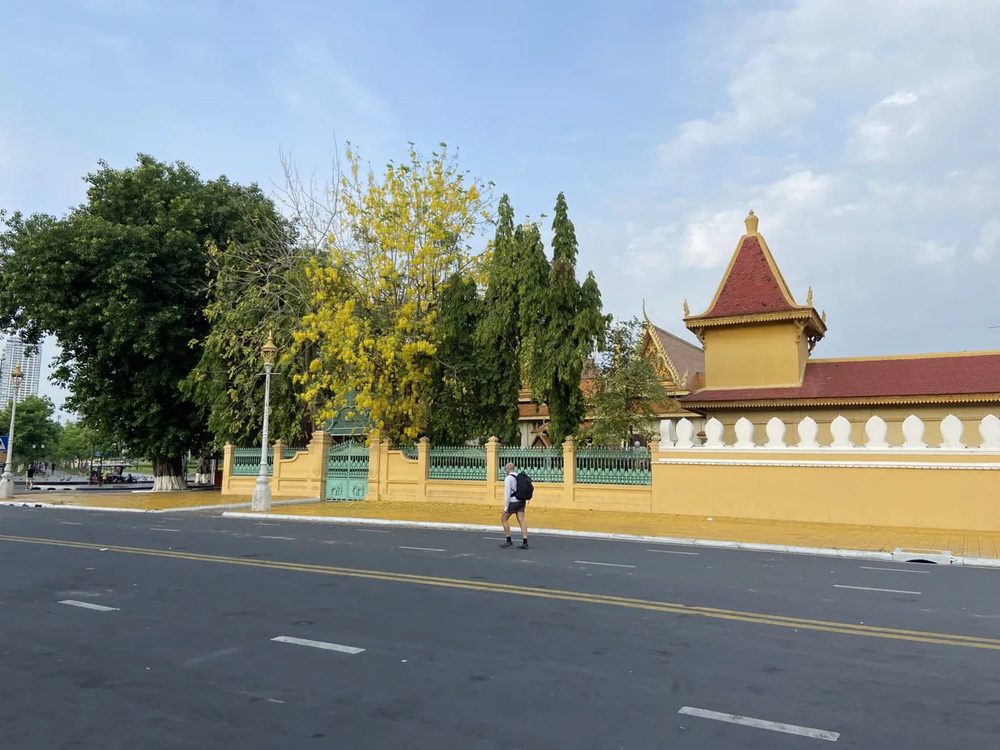

真正让人挪不动脚的是墙外的广场。草坪空旷，一个小孩坐在路边喂鸽子，鸽群起落，金顶凉亭立在逆光里。都说黄昏的王宫广场最好，他们大概没试过清晨——鸽子比人多。

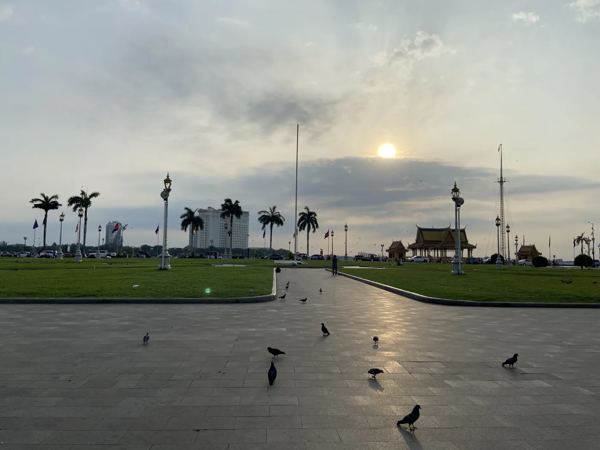

<figure><video controls preload="metadata" poster="images/phnompenh/IMG_3548.jpg" src="images/phnompenh/IMG_3548.mp4" playsinline></video><figcaption>沿王宫外墙移动的长镜头：明黄宫墙、棕榈树和红锥形殿顶（当日实拍视频）</figcaption></figure>

墙外的灯箱里还有另一种王室面孔：王太后诺罗敦·莫尼列——白色卷发盘起，珍珠项链，胸前别一朵红花，肖像下方的金字铭牌写着她的全衔。她是国王的母亲。母子两代的画像在同一条街上亮着，这座城市的敬意，就摆在每天路过的人眼前。

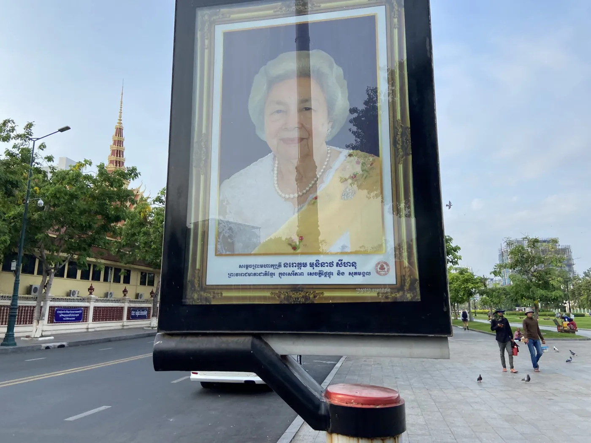

拐出广场，肚子开始提意见。在谷歌地图上搜"附近的美食"，结果只有一家：MASTER SUKI SOUP。走过去，价目牌上 $9.99，下面一行 Chivas $3.20——汤和威士忌挂同一块牌子。站在门口犹豫了一下：来柬埔寨，吃日本料理，多少有点傻。拍了一张，走了。

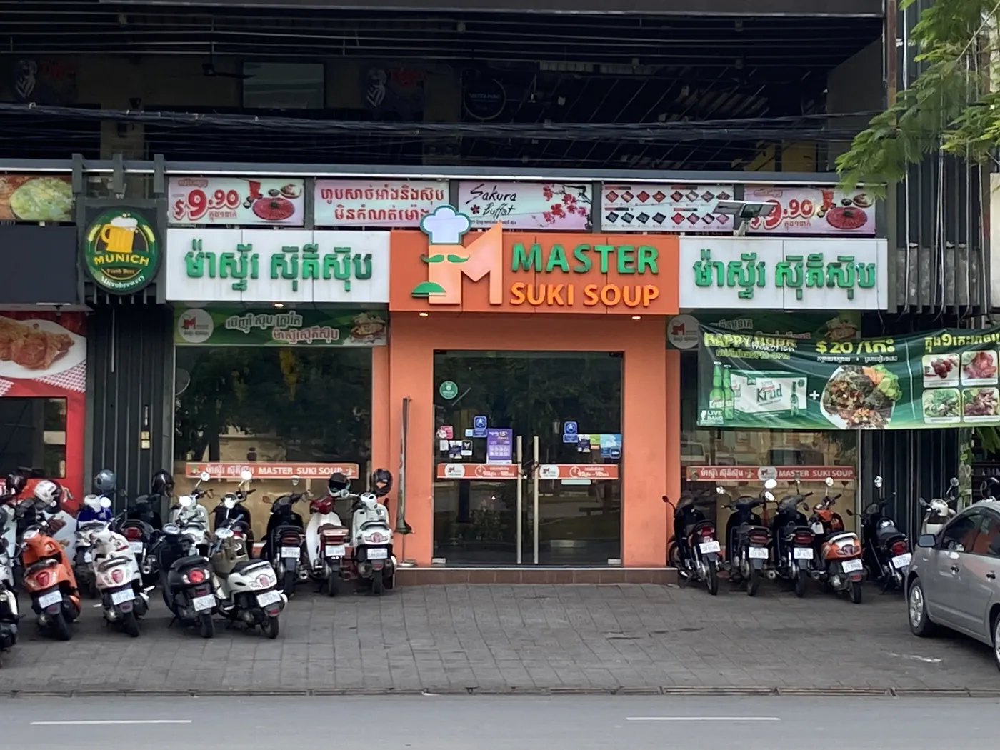

# 一盒牛奶走了半座城

七点，纪念碑广场。柬越友谊纪念碑的青铜群像里，两名士兵并肩站在后方：左边那位戴软帽，步枪竖在身侧，枪口朝天收着；右边那位戴圆盔，步枪横抱在腰间——枪管上停着一只鸽子。身前的妇人包头巾、着筒裙，双手抬在胸前，比两名士兵矮一头多。

为什么两个军人要站在一起？这碑自己就是答案：它 1982 年落成，纪念 1979 年 1 月 7 日越南军队与柬埔寨救国阵线推翻红色高棉，碑柱上一块铜牌镌着交叉的柬越两面国旗，把话说得很直白。柬方的叙事里这是解放，批评者的账本里那是占领——越南军队在这里一直待到 1989 年。同一座碑，在两种历史观里过着两种日子。

几百米外，西哈努克铜像立在金色的高棉亭子里；再往南，红砂岩的独立纪念碑层层收窄，收成一座吴哥式的塔尖。一座纪念友谊，一座纪念独立，隔着西哈努克大道遥遥相望。

广场上放着高棉音乐，从哪头传来的说不清。我举着手机拍了一圈广场，把大半首歌站着听完了——红色 City Bus 从广场边的马路慢慢滑过，Cellcard 的绿色广告灯箱亮得显眼。这几年我一直喜欢柬埔寨的老歌，歌单里躺着那首《看，猫头鹰》（Sat Tee Touy）。网上有传闻把它跟波尔布特扯在一起，查证下来是误传，它就是一首地道的高棉民歌——喜欢一首歌的理由，有时和传说无关，就是好听。

<figure><video controls preload="metadata" poster="images/phnompenh/IMG_3563.jpg" src="images/phnompenh/IMG_3563.mp4" playsinline></video><figcaption>纪念碑广场上放着高棉音乐，我站着听完大半首（当日实拍视频）</figcaption></figure>

纪念碑之间还夹着一段使馆区，像一条没标注的外交小路。蓝顶白墙的殖民老楼门口挂着两杆旗，门柱金匾上是印尼文；隔壁院子门前，五星红旗和柬埔寨国旗并排；再往前，一栋米色小别墅的铁艺大门里，一面旗让整条路安静下来——蓝红配色，白圆里一颗红星，靠旗杆一道白条。朝鲜驻金边大使馆。

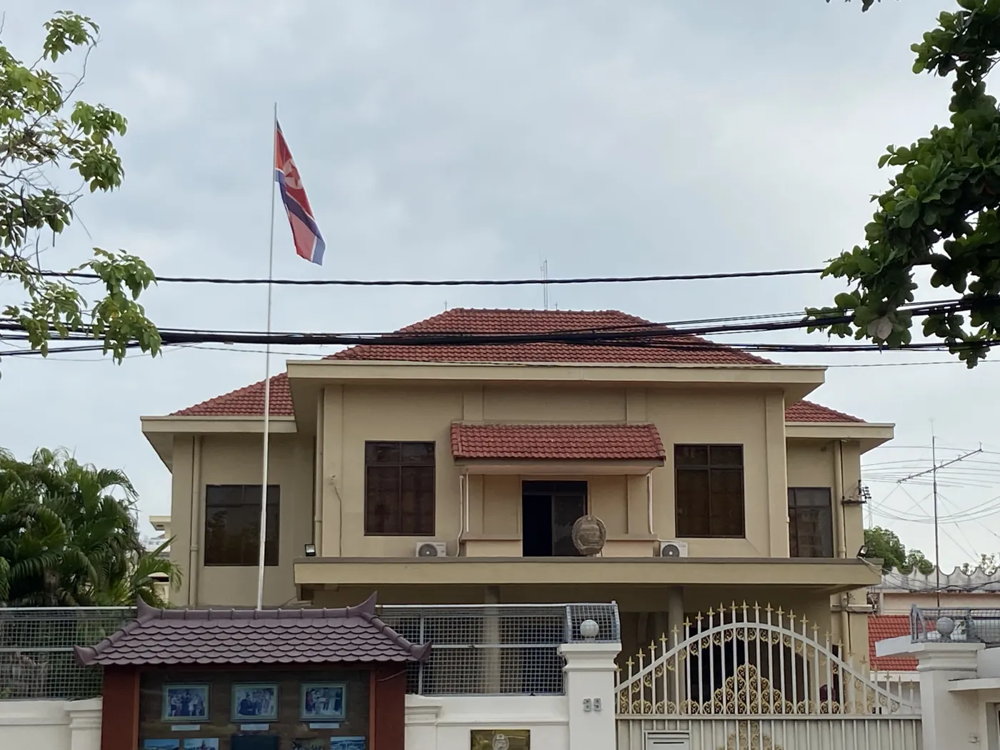

路边一张公交站牌也没放过——City Bus 的线路图把整座城织进一张网，从火车站一直标到远得没边的 Aeon Mall 3 SenSok。盯着那张图我想起一件扫兴的事：金边的机场搬了，新机场开在城南 19 公里外的乡野里，老机场本来就在市区边上。我本来盘算着，以后隔三差五再来一趟多好——老机场的时代，这才叫说来就来；现在，光是新机场那 19 公里，就够把兴致磨掉一半。

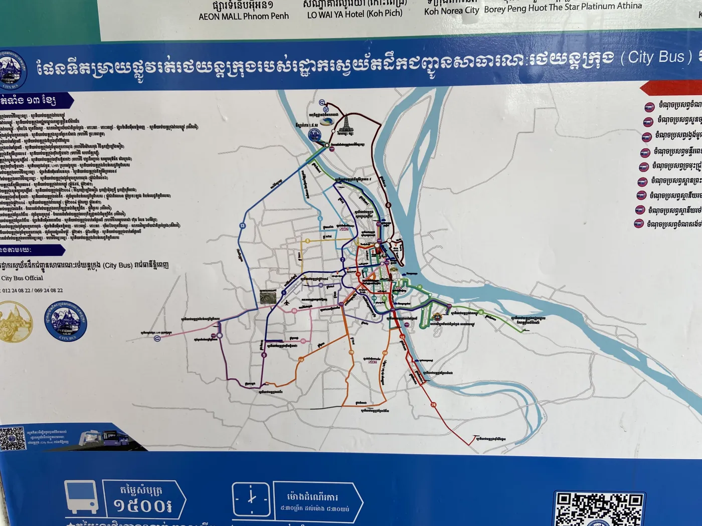

纪念碑和超市之间，还夹着一条奇怪的街：家家店门口都摆着一座座金色的多层小宫殿，蓝金的、白金的、红金的，檐角翘着凤头，大的有一人高，小的能捧在手心。我当时以为是四面佛，回来查了才知道，这些是柬埔寨店家门口供的土地神龛——招财、保平安；早上街角那只鎏金神龛里供的粉色汽水，就是给它准备的。整条街都在卖，生意应该不错。

<figure><video controls preload="metadata" poster="images/phnompenh/IMG_3594.jpg" src="images/phnompenh/IMG_3594.mp4" playsinline></video><figcaption>神龛一条街，店门口摆满待售的鎏金小宫殿（当日实拍视频）</figcaption></figure>

七点四十五分，便利店。不是计划里的早饭，是投降——日料汤店被否决之后，街上实在找不到能吃饭的地方，只能钻进店里。货架上三排 MAMA 杯面，冷柜里抽出一只 INDOMILK"GOOD Milk"，价签上是 4900。牛奶是我在路上最喜欢的东西之一：天热，人渴，它便宜、解渴、有蛋白质，一瓶下去，水和能量一起补齐。盒底的印尼文小字——TUTUP LEBIH RAPIK DAN AMAN，DOUBLE LOCK PROTECTION——说明它从雅加达出发，比我先到金边。此后它一直被拎在手里，陪我走完了城南的旧街巷。

城南的旧街巷里，藏着一个绕不开的地址：S21——吐斯廉屠杀博物馆。这里原本是一所中学，1975 到 1979 年间被红色高棉改成监狱，铁丝网缠上教学楼，几乎没有人活着走出去。我没有进去，在门口站了一会儿：灰白院墙上开着波纹铁皮大门，门楣上一行字写得很清楚，"TUOL SLENG GENOCIDE MUSEUM"。沿侧街再走两步，风化发黑的长条教学楼外覆着铁皮围挡，墙头一圈刀片刺网，门扇上贴着圆形的禁停标志。当年用来困住人的铁丝，今天圈着一段不许被忘记的历史。再往前，人力资源大学的白色拱门楼下停着三轮车，LK FAMILY MART 的红灯笼照常亮着——金边把最疼的一页，就翻在每天路过的地方。

# 从柬中友谊医院到皇家大学

从那条街出来，我误打误撞走进了一个大院：金色屋顶的佛殿一层叠一层，红漆大门，土场停满了车，旗杆上挂着柬埔寨国旗。手机正拍着，一声狗叫在脚边炸响，镜头猛地朝下一沉——一条狗不知什么时候凑到了腿边，我以为它要咬人。人和狗僵在原地，我居然把剩下的几秒拍完了：连成一片的殿檐确实好看，闯都闯进来了，不拍可惜。于是这段视频的前半段是佛殿，最后几秒，全是我鞋面前的碎石地面。后来想，那院子多半是寺院的，狗也多半是寺院的狗——它尽忠职守，我全身而退。

<figure><video controls preload="metadata" poster="images/phnompenh/IMG_3630.jpg" src="images/phnompenh/IMG_3630.mp4" playsinline></video><figcaption>误入寺院大院拍佛殿，狗叫一声，镜头朝下一沉（当日实拍视频）</figcaption></figure>

八点半以后，扫街继续。柬中友谊医院的白色矮门上刻着"CAMBODIA-CHINA FRIENDSHIP PREAH KOSSAMAK HOSPITAL"，门柱一边一国国旗；街口，中通快递的卡车等着红灯，车头的 ZTO 和中文一样不用翻译。再往北，美国太平洋国际学校立着中英双语的校牌，皇家金边大学的围墙上是一排金色的高棉文和"…PHNOM PENH UNIVERSITE ROYALE DE P…"的英文校名。

这座城市同时在施工。走了三个小时，塔吊没有离开过视野，绿色防护网从一栋玻璃塔楼罩到下一栋，老骑楼和在建的高层擦肩而过，嘟嘟车在两种天际线之间穿梭。说实话，这跟我想象里的柬埔寨对不上——出发前我以为它是个普普通通的慢城市，结果满城都是脚手架：韩国开发商在路边办楼盘开盘，中资地产挂出「投资咨询 土地买卖」，售楼处的红字就亮在茅草亭旁边。发达与否先不论，起码它没有一刻停下来。

中国元素不止开在商场里。S21 那片街区的老骑楼上，二楼贴着福字和春联，挂着红灯笼，底层是「陳金興 承做不銹鋼工業」的华人老铺；往北走，雅迪电动车的橙色帐篷支在街边，招牌上 YADEA 旁边还有一个 Sunra；再往前是一家火锅店，红色圆标上的书法写着「吉庆」。

再走十几分钟，转角那栋白色古典柱式的大楼上，竖式招牌亮出红底的铜钱标——中国银行，BANK OF CHINA；再过十分钟，一栋商业楼的侧面挂出中资地产的大红横幅，「久源地产投资有限公司」，底下的白牌小字写着「投资咨询 土地买卖」。电动车、火锅、银行、地产公司——中国来的营生，在金边各有各的门面。

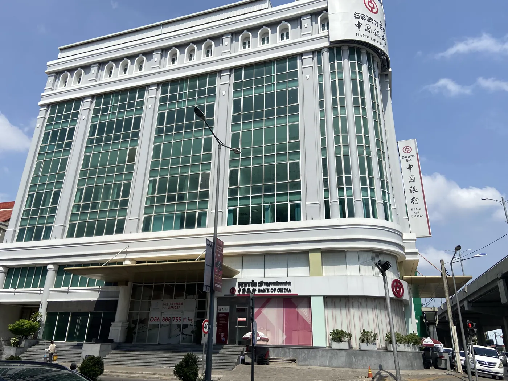

快离开前，我在 CENTURY PLAZA 门口停了一脚：蓝色弧形立面的商业广场，门前草坪上蹲着一尊卷着鼻子的白色大象雕塑。往里望，招牌上的中文比高棉文还密集——「三只松鼠」、「中国工艺商品展」的粉色横幅，甚至还有一家「云图国际医院」。几分钟前路过的手机街更直接：TECNO 的专卖店、蓝色充气拱门和楼顶的巨幅广告把一条街包圆，广告上代言人张艺兴穿一身黑西装，举着 CAMON 30，隔壁就是 vivo——传音的牌子、中国的偶像、柬埔寨的街口，三样东西摆在一起，居然一点也不违和。个中缘由不难猜：这座城市的电站和工地上，有大量中国来的建设者，商业广场于是先长成了半个故乡。这个现象说不上好还是坏，它只是结结实实地立在那里，被我在上午十点撞个正着。

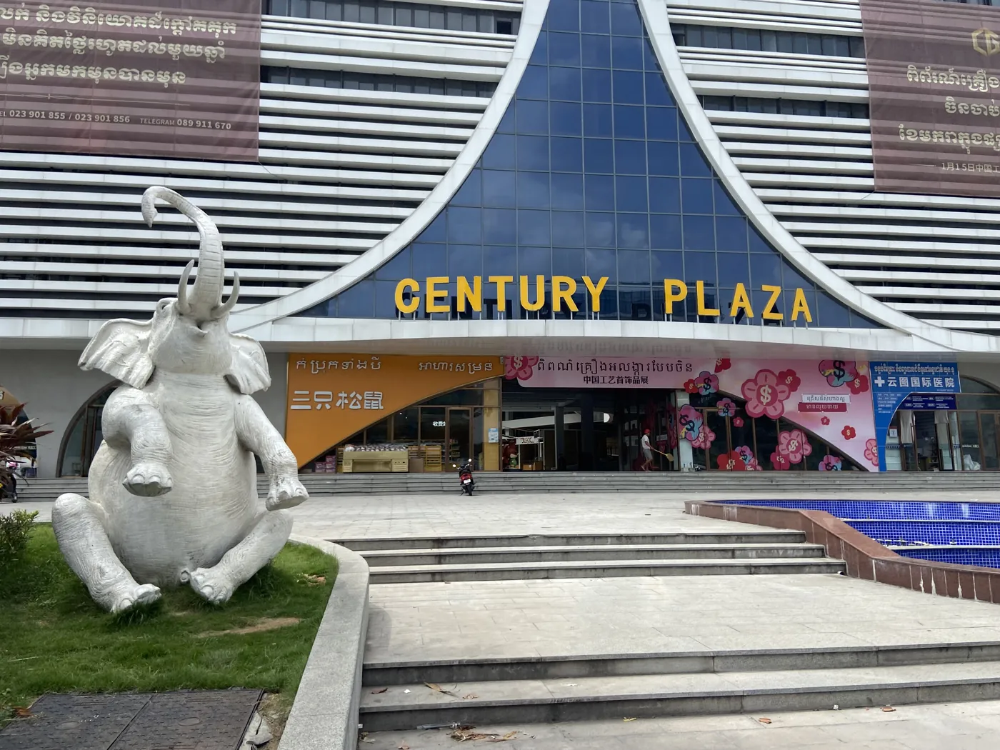

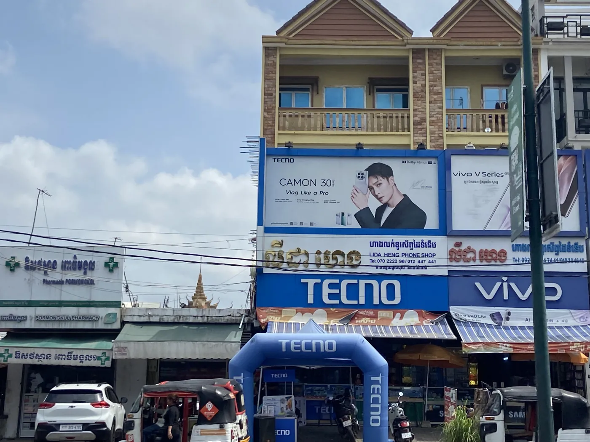

除了落地那晚的突突车，这十五个小时我全程步行——汤店门口往南，旧街巷、医院大门、大学围墙、塔吊和桥洞，一路用脚接到机场航站楼，一个人。一半是想凑近看看这座城市的日常，另一半是个人的私见：旅行是一种苦刑，更是一种修行——苦刑的部分是走路，修行的部分，也是走路。

# 十二点零二分

十点五十三分进机场，大厅白墙上画着城市天际线的剪影。这趟行程的下一站是泰国——免签入境，但有一条软规矩：移民官可能会请你出示现金，证明你养得起这趟旅行。于是值机大厅里出现了整趟行程最滑稽的一幕：我站在摄像头前展开一沓百元美钞，对着镜头笑。换了多少？三百还是五百美元，我到现在也没数清——反正它的全部意义，就是被人看一眼。

<figure><video controls preload="metadata" poster="images/phnompenh/sd1746160635_2.jpg" src="images/phnompenh/sd1746160635_2.mp4" playsinline></video><figcaption>值机大厅，展示"旅行能力"的一沓百元美钞（当日实拍视频）</figcaption></figure>

值机队伍边上有位女生搭话，说自己行李超限，请我帮忙把一张瑜伽垫捎过去。我拒绝了——瑜伽垫是软的，托付是陌生的，万一里面卷着什么不合法的东西，这笔账怎么算都亏。

免税店里最有亲切感的一幕：中华烟的红色灯箱上写着"58 元比香港便宜"，旁边竖着"四十美元 40$"。十一点五十四分在"Taste of Asia"的木格栅吊顶下坐了十分钟，十二点零二分，人已经在机舱座位上，屏幕亮着绿色的小字：viva。

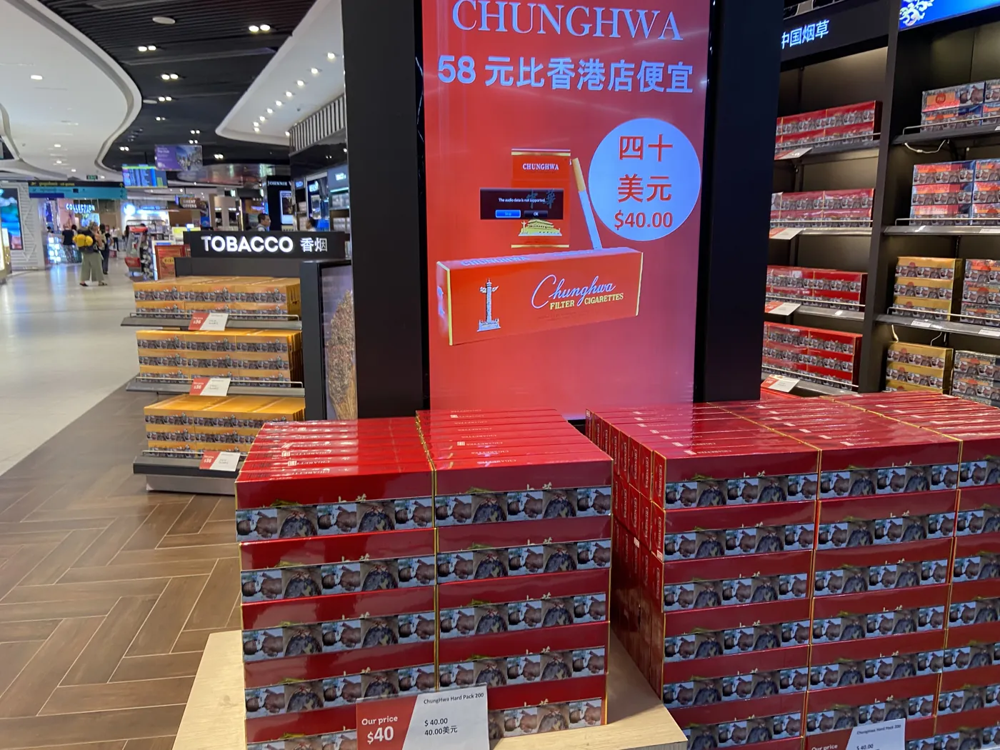

十五个小时，从一份深夜的披萨到一盒黎明前买的牛奶。金边没来得及给我任何完整的东西，它给的是一整段黎明——整座城市还没醒的时候，广场、河面和一千只鸽子，都只属于先出门的人。

# 手记

十五个小时的城市会留下什么？一张一美元的门票，一句"食材鲜 汤才鲜"，一盒 4900 的牛奶，和一场以披萨收场的货币谈判。金边把丰富压进了时间里，我只负责在黎明里快进。还有一件没想到的事：出发前我以为柬埔寨是个慢悠悠的普通城市，结果十五个小时里满眼都是塔吊、防护网和新开盘的售楼处——这座城市长得飞快，我去的时候，它刚好在建。有点后悔的是，这十五个小时里我把胃交给了披萨和一瓶便利店牛奶，当地的特色美食一口没尝。下次再来，想试试它的黄昏，把这些一样样补上。

实用信息：

- **行程节奏**：核心景点挤在河岸两公里内（中央市场—塔山—洞里萨河—王宫—纪念碑群），步行即可串完；我五点出门、正午登机，除了落地那晚的突突车，全程步行，最后一段是从城南一路走到机场。
- **塔山**：山门内外国人门票 1$（售票牌原文"FOR FOREIGNER ONLY / PLEASE PAY HERE / 1$ ONE PERSON"）；不进山门，绕山脚一圈也足够看，这座城的名字就来自它。
- **中央市场**：清晨六点前后只够逛外围，Art Deco 圆顶在外面看反而最完整。
- **货币**：满街价签直接标美元——门票 1$、汤 $9.99、免税店中华烟 40$；但突突车司机收瑞尔，落地先备一沓小额瑞尔，能省下一场谈判。
- **S21（吐斯廉屠杀博物馆）**：城南街口，原中学改建的红色高棉监狱旧址，金边最沉重的历史现场；我在门外看了看，内部展陈留给下次。
- **离境**：从金边飞泰国（免签入境），值机时可能被要求出示现金证明，备一沓美元在身上；陌生人的行李托付一律婉拒——再无害的瑜伽垫也别赌。
- **手机**：街上摩托多，飞车抢手机的传闻值得当真——我拍视频全程把手机端得很低，安全比构图重要。
- **机场**：2025 年 9 月起金边航班迁至城南约 19 公里的 Techo 国际机场（Kandal 省），不再紧贴市区——机场通勤要提前算进行程。
- **时段**：五月的金边日出在六点前后，黎明出门凉爽、无人，是这座城市的隐藏时段。

下一站，泰国。再下一站，西安。
