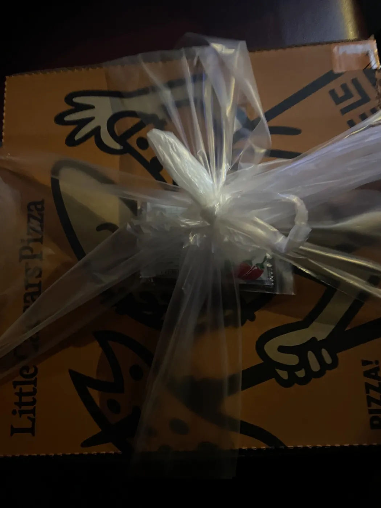
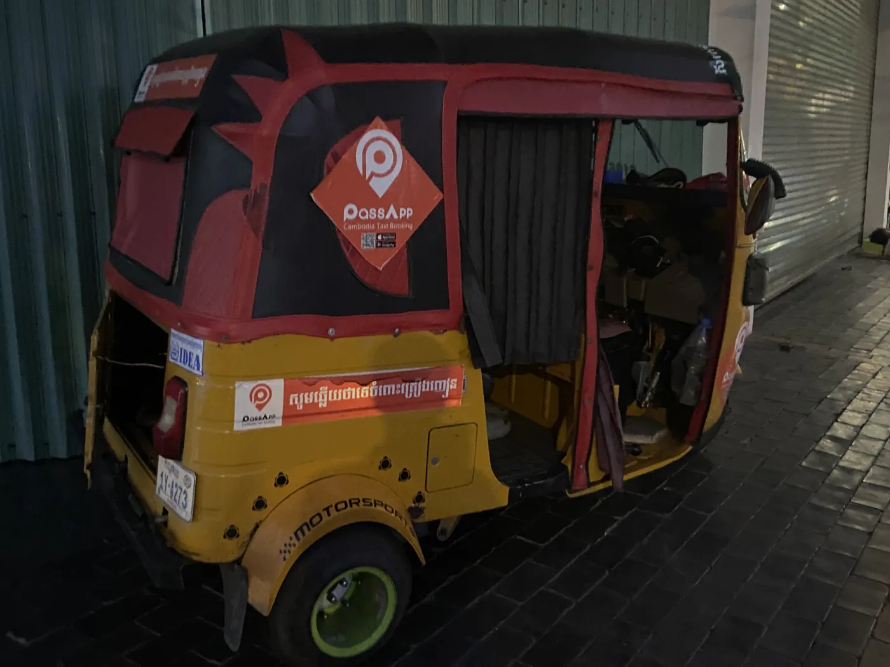
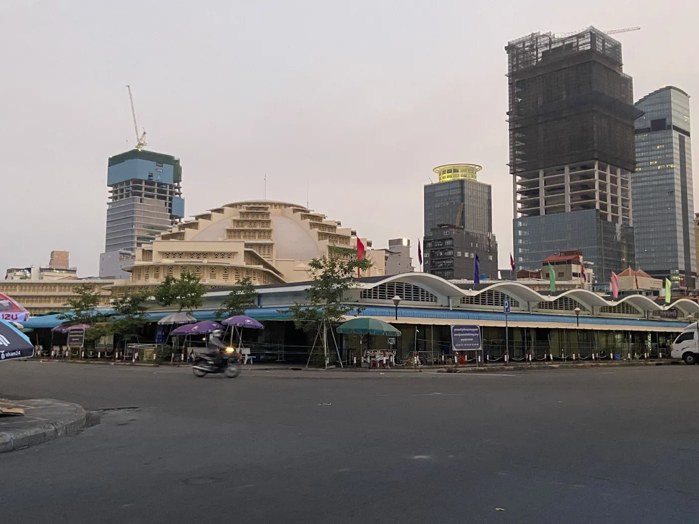
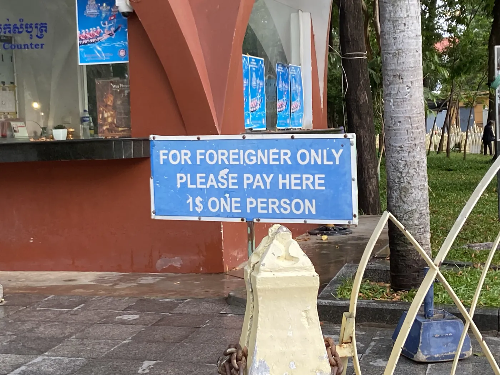
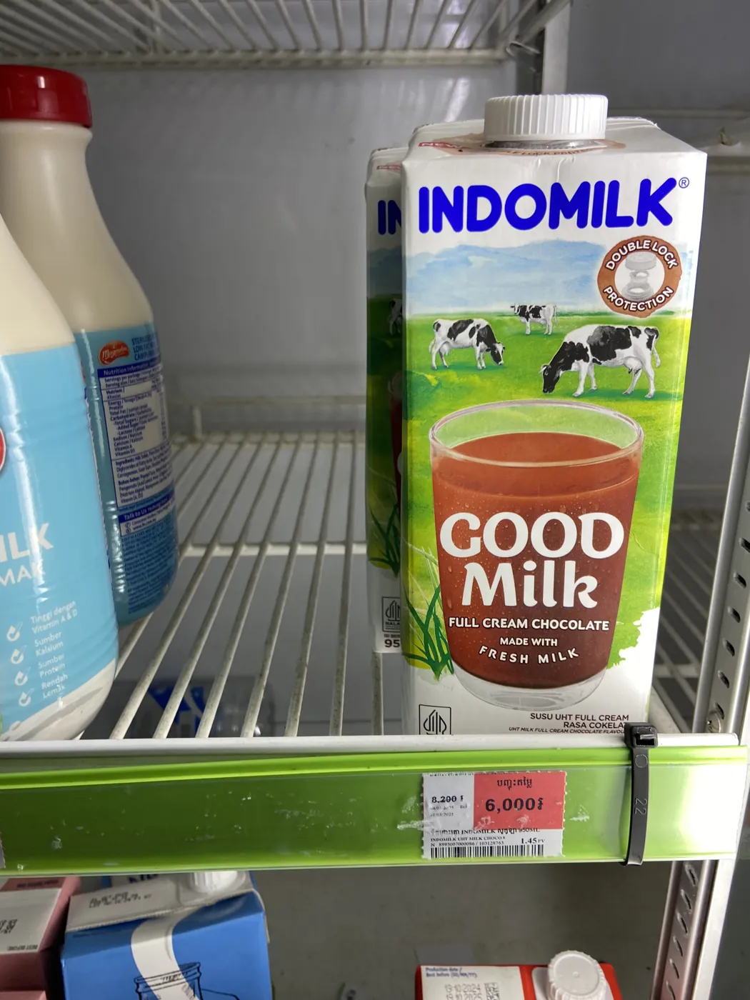
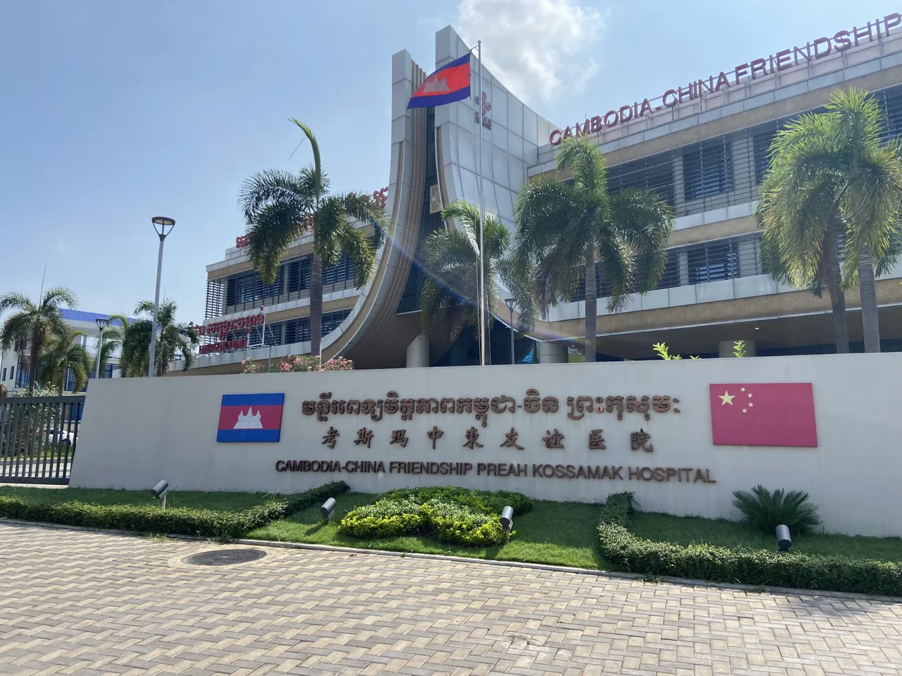

# 出发之前

行李里能证明这趟行程的东西很少：一张紫色的航线宣传卡，印着"在飞日韩、东南亚航线"，"西安 Xi'an"三个字被红色高亮，压在一本证件上面。五一的假期被切得零零碎碎，金边就塞在其中一截——晚上八点半落地，次日中午十二点的登机口，满打满算，十五个小时。

出发前对金边的想象只有两个词：王宫的金顶，和洞里萨河的日落。十五个小时后核对答案：日落一个没赶上，赶上的是日出。

# 夜里十点，先跟突突车司机吵了一架

金边的第一课在车轮上。落地已是夜里，摸上当地的突突车，红色的车厢内壁贴着三语禁烟标——高棉文、中文"请勿吸烟"、英文"NO SMOKING"并排。三个语种里我一眼看懂两个，剩下那个负责提醒我：已经到柬埔寨了。

真正的麻烦在付钱。司机开口要瑞尔，我身上只有美元，也没打算换——这个国家的价签明明到处写着美元，我想一路用到底。一沓美元找不开零，两个人隔着车斗僵持，谁也没说服谁。

车碾过夜色，先经过的是中餐街。整条街的灯箱都在用中文报菜名：「音乐烧烤 隆江猪脚饭」，底下三块小牌排开——"S329 老蔡椰子鸡""S329 万州烤鱼""S329 酸菜鱼"；隔壁的 LED 大字是「泰福猪肚鸡」，副行一行小字：食材鲜，汤才鲜。

最后既没吃猪脚饭也没吃猪肚鸡。我在街角找到一家 Little Caesars——小凯撒，在美国火得一塌糊涂的披萨连锁，没想到在金边撞见一家。买它的理由一半是馋，一半是私心：用美元结账，把大票换开。结果店家不肯换汇，找回的仍是瑞尔——我的钱包里第一次躺进高棉的纸币。十点零四分，这只系着塑料袋、掀开盖印着"PIZZA! PIZZA!"的薄底蟹柳披萨，把车费的问题解决了。

# 凌晨三点，整座城市还没醒

三点半，人躺在床上睁着眼。索性不熬了，五点出门——后来证明，这是整趟行程里最正确的一个决定。

清晨的街道属于另一群人：金铺的卷帘门还没拉起，"Ai-CHA ICE CREAM & TEA"和"Smell Coffee"都黑着灯，街角鎏金神龛里供着粉色的汽水。黄红配色的嘟嘟车停在路边，车尾一枚红色菱形的 Grab 标；一家汽修店的条纹雨棚下，日本国旗和柬埔寨国旗挂在一起。

五点二十八分，中央市场的穹顶从街口探出来。Art Deco 的奶白色圆顶配一列梯形长窗，红伞摊位还收在阴影里，天是粉紫色的。日头没上来，整座广场只属于零星几个早起的人。

<figure><video controls preload="metadata" poster="images/phnompenh/IMG_3454.jpg" src="images/phnompenh/IMG_3454.mp4" playsinline></video><figcaption>镜头从街口平移扫过中央市场正面的 Art Deco 塔楼和红绿遮阳伞（当日实拍视频）</figcaption></figure>

# 一美元的塔山，和河上的日出

金边（Phnom Penh）这个名字说的就是它——Phnom 是山，这座城因塔山得名。我们绕着走的那一圈，正是这座城市名字的来历。山不高，塔不险：灰白的石塔层层收拢，壁龛里的立像披着金绶带。我们没有上去，就围着山脚转了一整圈——纳迦栏柱引着金色的山门，张口卷毛的石狮守在粉砂岩的基座旁，绕到石阶口，先看见售票的蓝牌子："FOR FOREIGNER ONLY / PLEASE PAY HERE / 1$ ONE PERSON"。一美元一位，钉在墙上，是这趟旅行里被研究得最认真、却始终没有花出去的一美元。

六点过二分，太阳从洞里萨河对岸的楼群后面出来。河面把光摊平，对岸的高层楼群刚刚显出轮廓，双层观光游船泊在岸边；石狮和七头纳迦的扇形石雕立在水边，一条木栈道伸向河心，一条废弃的木壳游船搁在栈桥旁。

# 王宫的黄墙，和广场上的鸽子

金边的历史景点挤在河岸两公里内，从塔山脚下沿河走到王宫，像串门一样就到了。明黄色的围墙沿街铺开，金色门楼，红金屋顶，白色卫塔顶着金色尖顶。六点四十分，王座殿的蓝金配色屋顶在晨光里发亮，门前石狮还没等到第一批游客。

真正让人挪不动脚的是墙外的广场。草坪空旷，一个小孩坐在路边喂鸽子，鸽群起落，金顶凉亭立在逆光里。都说黄昏的王宫广场最好，他们大概没试过清晨——鸽子比人多。

<figure><video controls preload="metadata" poster="images/phnompenh/IMG_3548.jpg" src="images/phnompenh/IMG_3548.mp4" playsinline></video><figcaption>沿王宫外墙移动的长镜头：明黄宫墙、棕榈树和红锥形殿顶（当日实拍视频）</figcaption></figure>

拐出广场，肚子开始提意见。在谷歌地图上搜"附近的美食"，结果只有一家：MASTER SUKI SOUP。走过去，价目牌上 $9.99，下面一行 Chivas $3.20——汤和威士忌挂同一块牌子。站在门口犹豫了一下：来柬埔寨，吃日本料理，多少有点傻。拍了一张，走了。

# 一盒牛奶走了半座城

七点，纪念碑广场。柬越友谊纪念碑的青铜群像里有持枪的士兵、献果的妇人和孩童；几百米外，西哈努克铜像立在金色的高棉亭子里，红砂岩的独立纪念碑层层收窄，收成一座吴哥式的塔尖。

七点四十五分，超市。货架上三排 MAMA 杯面，冷柜里抽出一只 INDOMILK"GOOD Milk"，价签上是 4900。盒底的印尼文小字——TUTUP LEBIH RAPIK DAN AMAN，DOUBLE LOCK PROTECTION——说明这盒牛奶从雅加达出发，比我先到金边。此后两个小时它一直被拎在手里，陪我们走完了城南的旧街巷。

城南的街巷安静。旧机构的铁丝网后面是波纹铁皮围挡，一家 NGO 的大门上写着"TOTAL … AGAINST POVERTY"，人力资源大学的白色拱门楼下停着三轮车，LK FAMILY MART 的门口挂着红灯笼，24 小时的牌子亮着。

# 从柬中友谊医院到皇家大学

八点半以后，扫街继续。柬中友谊医院的白色矮门上刻着"CAMBODIA-CHINA FRIENDSHIP PREAH KOSSAMAK HOSPITAL"，门柱一边一国国旗；街口，中通快递的卡车等着红灯，车头的 ZTO 和中文一样不用翻译。再往北，美国太平洋国际学校立着中英双语的校牌，皇家金边大学的围墙上是一排金色的高棉文和"…PHNOM PENH UNIVERSITE ROYALE DE P…"的英文校名。

这座城市同时在施工。走了三个小时，塔吊没有离开过视野，绿色防护网从一栋玻璃塔楼罩到下一栋，老骑楼和在建的高层擦肩而过，嘟嘟车在两种天际线之间穿梭。

# 十二点零二分

十点五十三分进机场，大厅白墙上画着城市天际线的剪影。免税店里最有亲切感的一幕：中华烟的红色灯箱上写着"58 元比香港便宜"，旁边竖着"四十美元 40$"。十一点五十四分在"Taste of Asia"的木格栅吊顶下坐了十分钟，十二点零二分，人已经在机舱座位上，屏幕亮着绿色的小字：viva。

十五个小时，从一份深夜的披萨到一盒黎明前买的牛奶。金边没来得及给我任何完整的东西，它给的是一整段黎明——整座城市还没醒的时候，广场、河面和一千只鸽子，都只属于先出门的人。

# 手记

十五个小时的城市会留下什么？一张一美元的门票，一句"食材鲜 汤才鲜"，一个拎了两小时的牛奶盒，和一场以披萨收场的货币谈判。金边把丰富压进了时间里，我们只负责在黎明里快进。有点后悔的是，这十五个小时里我把胃交给了披萨和超市牛奶，当地的特色美食一口没尝。下次再来，想试试它的黄昏，把这些一样样补上。

实用信息：

- **行程节奏**：核心景点挤在河岸两公里内（中央市场—塔山寺—洞里萨河—王宫—纪念碑群），步行即可串完；我们五点出门、正午登机，全程没打一辆车。
- **塔山**：山门内外国人门票 1$（售票牌原文"FOR FOREIGNER ONLY / PLEASE PAY HERE / 1$ ONE PERSON"）；不进山门，绕山脚一圈也足够看，这座城的名字就来自它。
- **中央市场**：清晨六点前后只够逛外围，Art Deco 圆顶在外面看反而最完整。
- **货币**：满街价签直接标美元——门票 1$、汤 $9.99、免税店中华烟 40$；但突突车司机收瑞尔，落地先备一沓小额瑞尔，能省下一场谈判。
- **时段**：五月的金边日出在六点前后，黎明出门凉爽、无人，是这座城市的隐藏时段。

下一站，西安。
