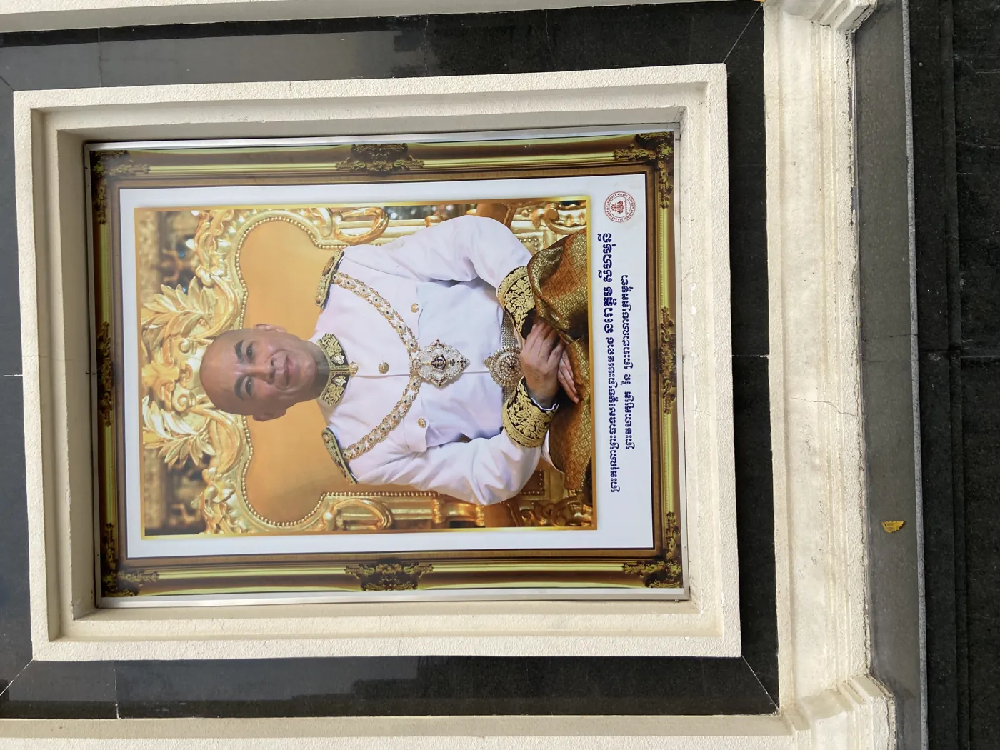
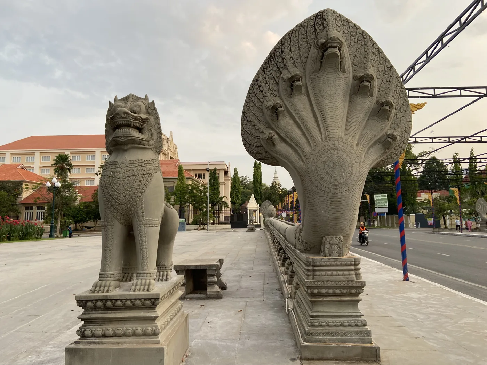
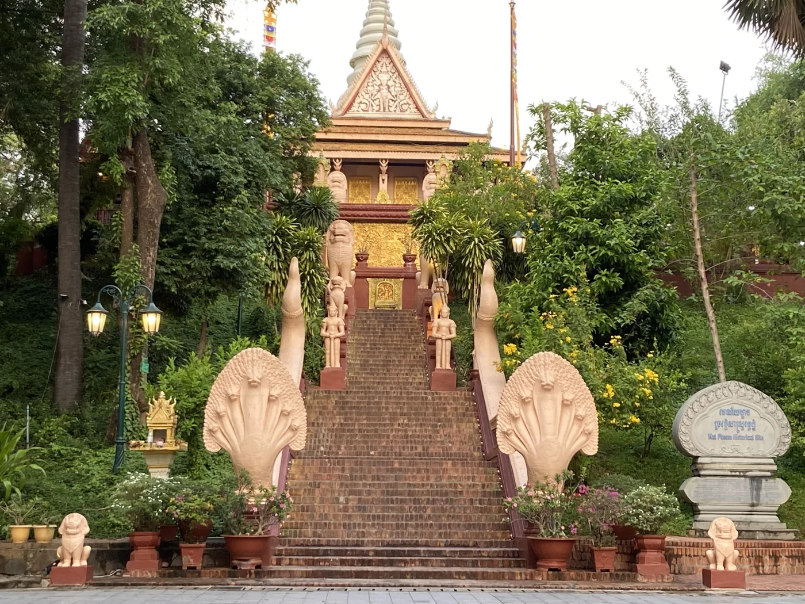
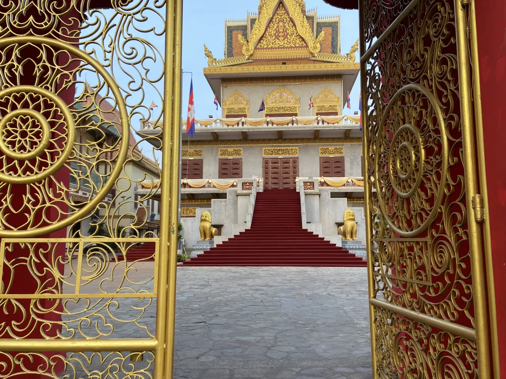
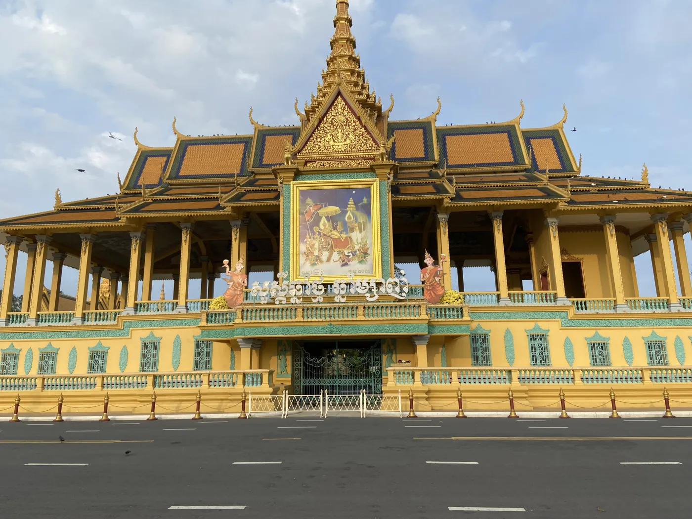
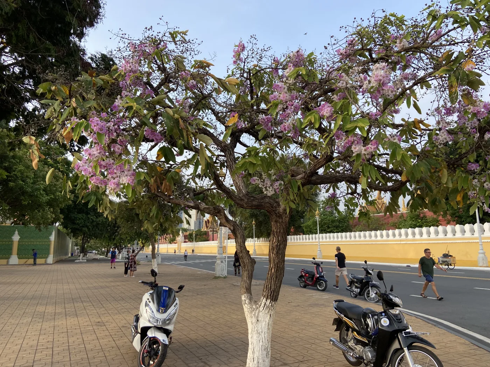
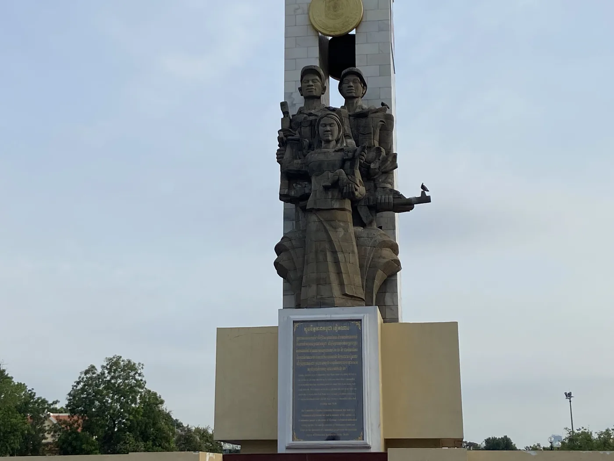
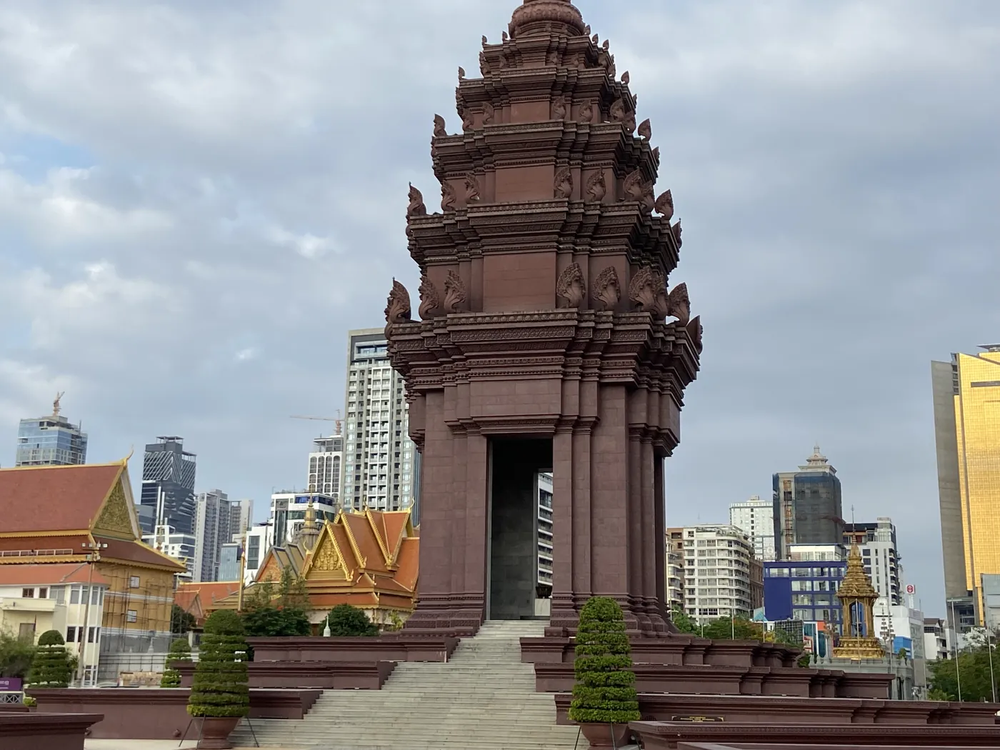
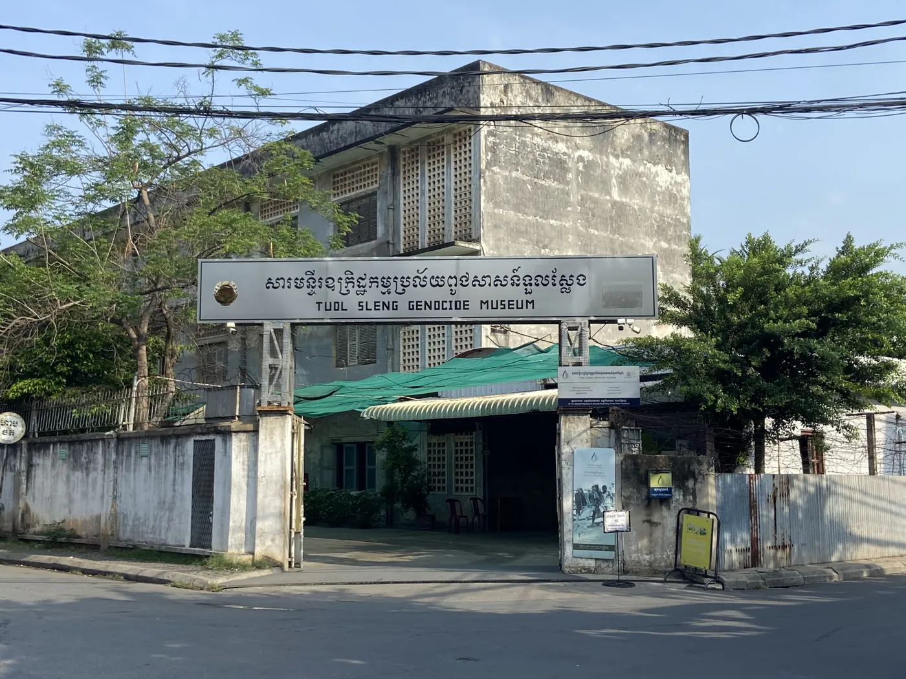

# 出发之前

五一的假期被切得零零碎碎，金边就塞在其中一截：夜里落地，次日中午的登机口，满打满算，十五个小时。出发前的想象只有两个词——王宫的金顶，和洞里萨河的日落。十五个小时后核对答案：日落一个没赶上，赶上的是日出。

# 先跟突突车司机吵了一架

金边的第一课在车轮上。落地的深夜摸上突突车，司机开口要瑞尔，我身上只有美元——一沓找不开零的大票。两个人隔着车斗僵持，谁也没说服谁。

僵持最后是让一份披萨化解的。街角正好有家 Little Caesars——小凯撒，在美国火得一塌糊涂的连锁，没想到在金边撞见一家。吃它一半是馋，一半是私心：用美元结账，把大票换开。结果店家不肯换汇，找回的仍是瑞尔——我的钱包里第一次躺进高棉的纸币，车费的事也顺带谈拢了。

# 趁整座城市还没醒出门

天没亮，中央市场的穹顶就从街口探出来。Art Deco 的奶白色圆顶配一列梯形长窗，红伞摊位还收在阴影里，天是粉紫色的。日头没上来，整座广场只属于零星几个早起的人。

<figure><video controls preload="metadata" poster="images/phnompenh/IMG_3454.jpg" src="images/phnompenh/IMG_3454.mp4" playsinline></video><figcaption>镜头从街口平移扫过中央市场正面的 Art Deco 塔楼和红绿遮阳伞（当日实拍视频）</figcaption></figure>

# 塔山，和河上的日出

金边（Phnom Penh）这个名字说的就是它——Phnom 是山，这座城因塔山得名。我绕着走的那一圈，正是这座城市名字的来历。

其实，来塔山的路上就先见过国王了。路边一面奶白色的墙龛里，金框画像上是白色礼服军装的老人——金色肩章、金领链，背景是金殿王座，底下一行高棉文写着他名字的全称：诺罗敦·西哈莫尼。后来一整天，这种肖像见了无数次：金铺旁边有，铁皮棚底下也有。国王在这里不常出现在新闻里，因为他一直在墙上。

来塔山的路上，还先认识了这条蛇——纳迦（Nāga），高棉神话里的七头蛇神，管水。河岸广场上它展开了最大的一面：七颗蛇头从一条躯干上散成扇形，颗颗张口露牙，和一只胸前满雕璎珞纹的高棉石狮同立在须弥座上。此后一整天，它无处不在：塔山的石阶栏柱是它盘的，寺墙、桥头、檐角都是它。高棉人甚至把王室血统也追到它身上——传说古高棉王的先祖娶了纳迦的公主。看多了你会记住那个剪影：一条蛇，昂起七颗头。

山不高，塔不险：灰白的石塔层层收拢，壁龛里的立像披着金绶带。我没有上去，就围着山脚转了一整圈——纳迦栏柱引着金色的山门，张口卷毛的石狮守在粉砂岩的基座旁。

太阳从洞里萨河对岸的楼群后面出来。河面把光摊平，对岸的高层楼群刚刚显出轮廓，双层观光游船泊在岸边；石狮和七头纳迦的扇形石雕立在水边，一条木栈道伸向河心，一条废弃的木壳游船搁在栈桥旁。

# 王宫的黄墙，和广场上的鸽子

金边的历史景点挤在河岸两公里内，从塔山脚下沿河走到王宫，像串门一样就到了。

串门路上的第一座院子不是王宫，是国家博物馆。离开门还早，门口白牌写着「OPEN DAILY」，开放时间 8:00AM - 5:00PM，成人票 10 美元。隔着红色铁艺栅栏往里看：一整片红陶色的建筑连成一体，层叠的红瓦尖顶，中央一座白色塔刹，庭院里立着神鸟伽鲁达的石雕——十五个小时的人，连这座红宫殿也只能从栏杆外整组带走。

<figure><video controls preload="metadata" poster="images/phnompenh/IMG_3530.jpg" src="images/phnompenh/IMG_3530.mp4" playsinline></video><figcaption>沿国家博物馆红色铁艺围栏横摇：红陶墙、层叠尖顶，结尾摇到鎏金馆名（当日实拍视频）</figcaption></figure>

明黄色的围墙沿街铺开，金色门楼，红金屋顶，白色卫塔顶着金色尖顶。王座殿的蓝金配色屋顶在晨光里发亮，门前石狮还没等到第一批游客。

沿墙往南，撞见一棵开粉紫色花的大树：碎花挤成一团团的花簇，缀在绿叶和光秃的细枝之间，树干下半截刷着白灰。粉花压着明黄宫墙和白色宝瓶栏杆，远处探出王宫的金尖顶，两辆摩托一左一右停在树下——这堵明黄的墙天天被人拍，这个早晨却归了这棵树。

真正让人挪不动脚的是墙外的广场。草坪空旷，一个小孩坐在路边喂鸽子，鸽群起落，金顶凉亭立在逆光里。都说黄昏的王宫广场最好，他们大概没试过清晨——鸽子比人多。

<figure><video controls preload="metadata" poster="images/phnompenh/IMG_3548.jpg" src="images/phnompenh/IMG_3548.mp4" playsinline></video><figcaption>沿王宫外墙移动的长镜头：明黄宫墙、棕榈树和红锥形殿顶（当日实拍视频）</figcaption></figure>

# 从纪念碑广场到 S21

纪念碑广场上，柬越友谊纪念碑的青铜群像里，两名士兵并肩站在后方：左边那位戴软帽，步枪竖在身侧，枪口朝天收着；右边那位戴圆盔，步枪横抱在腰间——枪管上停着一只鸽子。身前的妇人包头巾、着筒裙，双手抬在胸前，比两名士兵矮一头多。

为什么两个军人要站在一起？这碑自己就是答案：它 1982 年落成，纪念 1979 年 1 月 7 日越南军队与柬埔寨救国阵线推翻红色高棉，碑柱上一块铜牌镌着交叉的柬越两面国旗，把话说得很直白。柬方的叙事里这是解放，批评者的账本里那是占领——越南军队在这里一直待到 1989 年。同一座碑，在两种历史观里过着两种日子。

几百米外，西哈努克铜像立在金色的高棉亭子里；再往南，红砂岩的独立纪念碑层层收窄，收成一座吴哥式的塔尖。一座纪念友谊，一座纪念独立，隔着西哈努克大道遥遥相望。

广场上放着高棉音乐，从哪头传来的说不清。我举着手机拍了一圈广场，把大半首歌站着听完了——红色 City Bus 从广场边的马路慢慢滑过，Cellcard 的绿色广告灯箱亮得显眼。这几年我一直喜欢柬埔寨的老歌，歌单里躺着那首《看，猫头鹰》（Sat Tee Touy）。网上有传闻把它跟波尔布特扯在一起，查证下来是误传，它就是一首地道的高棉民歌——喜欢一首歌的理由，有时和传说无关，就是好听。

<figure><video controls preload="metadata" poster="images/phnompenh/IMG_3563.jpg" src="images/phnompenh/IMG_3563.mp4" playsinline></video><figcaption>纪念碑广场上放着高棉音乐，我站着听完大半首（当日实拍视频）</figcaption></figure>

纪念碑之间还夹着一段使馆区，像一条没标注的外交小路。蓝顶白墙的殖民老楼门口挂着两杆旗，门柱金匾上是印尼文；隔壁院子门前，五星红旗和柬埔寨国旗并排；再往前，一栋米色小别墅的铁艺大门里，一面旗让整条路安静下来——蓝红配色，白圆里一颗红星，靠旗杆一道白条。朝鲜驻金边大使馆。

从使馆区出来，路边还夹着一条奇怪的街：家家店门口都摆着一座座金色的多层小宫殿，蓝金的、白金的、红金的，檐角翘着凤头，大的有一人高，小的能捧在手心。我当时以为是四面佛，回来查了才知道，这些是柬埔寨店家门口供的土地神龛——招财、保平安。整条街都在卖，生意应该不错。

<figure><video controls preload="metadata" poster="images/phnompenh/IMG_3594.jpg" src="images/phnompenh/IMG_3594.mp4" playsinline></video><figcaption>神龛一条街，店门口摆满待售的鎏金小宫殿（当日实拍视频）</figcaption></figure>

城南的旧街巷里，藏着一个绕不开的地址：S21——吐斯廉屠杀博物馆。这里原本是一所中学，1975 到 1979 年间被红色高棉改成监狱，铁丝网缠上教学楼，几乎没有人活着走出去。我没有进去，在门口站了一会儿：灰白院墙上开着波纹铁皮大门，门楣上一行字写得很清楚，"TUOL SLENG GENOCIDE MUSEUM"。沿侧街再走两步，风化发黑的长条教学楼外覆着铁皮围挡，墙头一圈刀片刺网，门扇上贴着圆形的禁停标志。当年用来困住人的铁丝，今天圈着一段不许被忘记的历史。再往前，人力资源大学的白色拱门楼下停着三轮车，LK FAMILY MART 的红灯笼照常亮着——金边把最疼的一页，就翻在每天路过的地方。

# 满城的塔吊

这座城市同时在施工。走了三个小时，塔吊没有离开过视野，绿色防护网从一栋玻璃塔楼罩到下一栋，老骑楼和在建的高层擦肩而过，嘟嘟车在两种天际线之间穿梭。说实话，这跟我想象里的柬埔寨对不上——出发前我以为它是个普普通通的慢城市，结果满城都是脚手架：韩国开发商在路边办楼盘开盘，中资地产挂出「投资咨询 土地买卖」，售楼处的红字就亮在茅草亭旁边。发达与否先不论，起码它没有一刻停下来。

除了落地那晚的突突车，这十五个小时我全程步行——纪念碑、旧街巷、塔吊和桥洞，一路用脚接到机场航站楼，一个人。一半是想凑近看看这座城市的日常，另一半是个人的私见：旅行是一种苦刑，更是一种修行——苦刑的部分是走路，修行的部分，也是走路。

# 正午的登机口

进了机场，大厅白墙上画着城市天际线的剪影。这趟行程的下一站是泰国。

登机前在"Taste of Asia"的木格栅吊顶下坐了十分钟，随后人已经在机舱座位上，屏幕亮着绿色的小字：viva。

十五个小时，从一份深夜的披萨开始，到一整个没醒的黎明收尾。金边没来得及给我任何完整的东西，它给的是一整段黎明——整座城市还没醒的时候，广场、河面和一千只鸽子，都只属于先出门的人。

# 手记

十五个小时的城市会留下什么？一尊七头纳迦的雕像，一段站着听完的高棉老歌，和一场以披萨收场的货币谈判。金边把丰富压进了时间里，我只负责在黎明里快进。还有一件没想到的事：出发前我以为柬埔寨是个慢悠悠的普通城市，结果十五个小时里满眼都是塔吊、防护网和新开盘的售楼处——这座城市长得飞快，我去的时候，它刚好在建。有点后悔的是，这十五个小时里我把胃交给了披萨，当地的特色美食一口没尝。下次再来，想试试它的黄昏，把这些一样样补上。

实用信息：

- **行程节奏**：核心景点挤在河岸两公里内（中央市场—塔山—洞里萨河—王宫—纪念碑群），步行即可串完；我清晨出门、正午登机，除了落地那晚的突突车，全程步行，最后一段是从城南一路走到机场。
- **塔山**：山门内外国人门票 1$；不进山门，绕山脚一圈也足够看，这座城的名字就来自它。
- **中央市场**：清晨六点前后只够逛外围，Art Deco 圆顶在外面看反而最完整。
- **货币**：满街价签直接标美元——门票 1$，深夜的披萨也用美元结；但突突车司机收瑞尔，落地先备一沓小额瑞尔，能省下一场谈判。
- **S21（吐斯廉屠杀博物馆）**：城南街口，原中学改建的红色高棉监狱旧址，金边最沉重的历史现场；我在门外看了看，内部展陈留给下次。
- **离境**：从金边飞泰国（免签入境），值机时可能被要求出示现金证明，备一沓美元在身上；陌生人的行李托付一律婉拒。
- **手机**：街上摩托多，飞车抢手机的传闻值得当真——我拍视频全程把手机端得很低，安全比构图重要。
- **机场**：2025 年 9 月起金边航班迁至城南约 19 公里的 Techo 国际机场（Kandal 省），不再紧贴市区——机场通勤要提前算进行程。
- **时段**：五月的金边日出在六点前后，黎明出门凉爽、无人，是这座城市的隐藏时段。

下一站，泰国。再下一站，西安。
